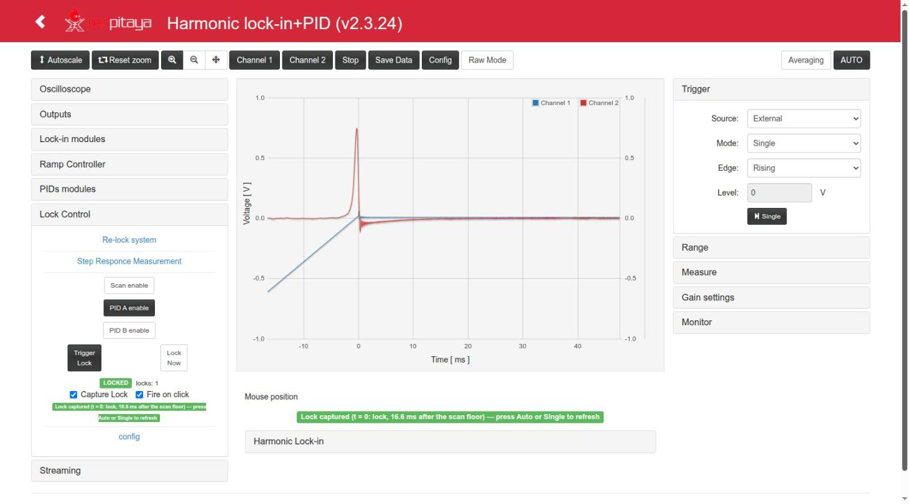

# Red Pitaya Lock-in+PID Application with HARMONIC modulation

This started being a striped version of [lock-in+PID](https://github.com/marceluda/rp_lock-in_pid) project. Now it incorporated some new features that make it another App.

It is an application for the [Red Pitaya STEMlab 125-14](https://www.redpitaya.com/) board (RP): a set of
instruments built in the FPGA (oscilloscope, harmonic lock-in amplifier, two PIDs, ramp generator and
automatic lock control) to measure a system with modulation techniques and stabilize it with a feedback
loop, controlled from a web page or remotely over HTTP.

[](http://www.youtube.com/watch?v=330eYE75MYQ "Fast demosatration of usage")




## Version 2.3.x (Ecosystem 2.0)

Current version: **2.3.28** (branch `master`).

This version is **based on the 0.3.x series (v0.3.11), but with the FPGA design built in Vivado 2020.1**,
using the project structure of [RedPitaya-FPGA](https://github.com/RedPitaya/RedPitaya-FPGA).
It is intended for the Red Pitaya **Ecosystem 2.0** (e.g. `RedPitaya_OS_2.04`; tested on 2.04-35).
Since 2026-10-15 the branch `master` holds the 2.x series; the 0.3.x series (FPGA with Vivado 2015.2), for the
0.9x / 1.0 ecosystems, stays in the tags `v0.3` .. `v0.3.11`.

- Web interface and C controller: those of v0.3.11 plus the Ecosystem 2.0 changes of v2.3.10 and the
  fixes of v2.3.12 to v2.3.28 (see [CHANGELOG](CHANGELOG.md))
  (still built with Vivado 2015.2 SDK + Linaro toolchain).
- FPGA: ported to Vivado 2020.1 (see [Building](#building)), oscilloscope of the Ecosystem 2.0 with the
  decimation widened to 20 bits (time ranges up to ~68 s).
- v2.3.13: the lock control runs entirely in the FPGA. `lock_control` (0x18) is command + configuration
  and is never rewritten; the read-only `lock_status` (0x1C, replaces `lock_feedback`) gives armed /
  locked / effective enables / lock count. A lock can be closed from Python writing only registers
  (`py/lock_from_registers.py`). See [lock_in+pid_harmonic/doc/lock_control.md](lock_in+pid_harmonic/doc/lock_control.md).
- v2.3.14: **Capture Lock** (each lock request from the page captures the closing of the loop in the scope,
  triggered by the lock event, and freezes it until Auto / Single) and **Fire on click** (a click with
  *Choose from graph* sets the value and fires Trigger Lock). See
  [lock_in+pid_harmonic/doc/lock_capture.md](lock_in+pid_harmonic/doc/lock_capture.md).
- v2.3.15: **HTTP remote control on Ecosystem 2.0** (`/osc` acquisitions with the new `TrgUnlock` register;
  `control_finn.py` with PID, ramp, lock-in and lock helpers), lock time trigger of 32 bits (up to 34.36 s),
  register ranges matching the FPGA.
- v2.3.16: `control_finn.py` stops the scope of the web page before acquiring (`scope_stop()` /
  `scope_auto()`, minimal `POST /data`); the *Time trigger* / *Level trigger* fields accept units
  (`16.58 ms`, `20 s`, `0.1 V`); an emptied field is no longer sent as 0.
- v2.3.17: exact bus reads of fast signals (`in1`, `oscA`: ~2-3 % of the reads were corrupt), Config → load
  applies the time window in the right units, `control_finn.py` resolves the host name once.
- v2.3.18: minor fixes (same FPGA): lock trigger registers written from Python shown and kept by the page,
  Single mode keeps a slow poll, Config → load without read-only keys, X+ up to 68.7 s, streaming processes
  without the fds of nginx and with a higher priority, `lock_from_registers.py --time` clamped.
  See [doc/Remote.md](doc/Remote.md) for the remote control and a known issue of the Ecosystem (`POST /data`).
- v2.3.19: FPGA timing almost closed (WNS −8.954 → −1.099 ns) with pipeline registers in the lock-in, PIDs,
  generator and outputs: the lock-in outputs come 16 ns later, the PID outputs and the DAC outputs 8 ns later each
  (LOCK MODE loop +32 ns); same behaviour otherwise. See
  [lock_in+pid_harmonic/doc/lock_latency.md](lock_in+pid_harmonic/doc/lock_latency.md).
- v2.3.20: the references reach the lock-in 1 clock later (compensation of the output register of v2.3.19):
  the phase measured through DAC → system → ADC is again the one of v2.3.18 (WNS −0.888 ns).
- v2.3.21: **Reset zoom** sets the scope to one period of the ramp (Ext Trig = Scan floor / Scan ceil), one period
  of the modulation (Ext Trig = harmonic mod.) or one whole memory at the current Dec (otherwise), and Y to
  −1 … 1 V (raw mode −8192 … 8192); during a lock capture it first ends it (as AUTO). Raw Mode rescales Y the same way.
- v2.3.22: **mouse wheel on the scope**: no key zooms both axes, **SHIFT** only the time axis (cursor ↔), **ALT** only
  the Y axes (cursor ↕); time window kept within 20 ns … 68.7 s; during a lock capture the zoom stays in the page.
- v2.3.23: **slow scans** (windows ≥ 1.5 s, e.g. a 30 s ramp): the scope trace never mixes samples of an older lap of
  its memory; Capture Lock works with Time, Level and Lock Now (the lock request is applied once the scope has its
  history before the lock); the capture is drawn while it is acquired and "LOCKED but not captured" only appears if
  the scope really missed it; Reset zoom on a slow scan uses 0.98 × the period so that every scan is acquired;
  (FPGA) a time trigger armed after the ramp was stopped (e.g. right after releasing a lock) waits for the next scan
  floor instead of firing in the middle of the scan.
- v2.3.24: **scope presets** below Ext Trig: `in1|in2`, `in1|ctrl`, `X|Y`, `in1|err`, `ctrl|err` and `usr` (a pair of
  the user: double click to choose it; saved in the browser and in the configs). They change only OscA/OscB (not the
  zoom nor the trigger). Picking an **Ext Trig** other than None sets the Trigger panel to External + Normal.
- v2.3.25: choosing *Mode = Single* in the trigger select during a long acquisition (e.g. a 30 s scan) completes the
  trace already being acquired (before, it stayed cut where it was); "Square mod." (not implemented) is no longer in
  the Ext Trig menu.
- v2.3.26: **Auto** waits for the trigger (Ext Trig or the level of a channel) and forces an acquisition only if none
  comes within max(0.25 s, 1.1 × window, 1.1 × period of the Ext Trig when known) + 50 ms: with Ext Trig = Scan floor
  t = 0 is the scan floor in Auto too (before, Auto triggered at once, at any phase of the scan). Also: the option **Don't turn on PIDs and Ramp on config loading** (Config dialog) is now unchecked by
  default: *Config → load* / *Load file* (and the restore after a Restart) bring back the ramp (Scan enable) and the
  PIDs as saved, so a config saved while scanning loads scanning. Checking it keeps the previous protection.
- v2.3.27: Config dialog: **Load last config on init** (checked by default, saved in the browser): the App opens with
  the last settings used in this browser (also in a new tab); unchecked, it opens with its defaults. Buttons **Load last
  config** and **Reset to defaults** restart the App with them. The **Lock Control** panel is now right below Outputs.
- v2.3.28: **Lock Control**: three small buttons **time** / **level** / **time+level** between Trigger Lock and Lock
  Now: one click on a button and one on the graph set the trigger type and value and fire Trigger Lock. Fixed: a click
  with Choose from graph + Fire on click during a POST in flight lost the new values or the re-lock.


## Features

- Lock-in amplifier
- in-phase and quadrature Demodulation
  - Demodulation for arbitrary phase
  - Demodulatión for double and triple frequency
- Harmonic modulation from 3 Hz to 49.6 kHz, added to the outputs
- Two PID filters, for loop back stabilization
- Ramp/Scan controller for response analysis
- Lock control for automatic scan-stop / PID start (time, level or immediate trigger, run by the FPGA)
- Two-channel oscilloscope on any internal signal, triggered by internal events (scan floor, lock, ...)
- Streaming system for continued acquisition of two channels
- Remote control through HTTP API

**New Interface for lock-in R & Phase** :

[](http://www.youtube.com/watch?v=DzSK8IQkUE4 "New R-phase interphase")

**More decimaion values**

| dec    | max oscilloscope lenght |
|--------|-------------------------|
|      1 |             0.131072 ms |
|      8 |             1.048576 ms |
|     64 |             8.388608 ms |
|    128 |            16.777216 ms |
|    256 |            33.554432 ms |
|    512 |            67.108864 ms |
|   1024 |           134.217728 ms |
|   8192 |           1.073741824 s |
|  65536 |           8.589934592 s |
| 524288 |          68.719476736 s |


## Documentation

| Document | Contents |
|---|---|
| [doc/App.md](doc/App.md) | Instruments and technical data |
| [doc/Usage.md](doc/Usage.md) | Web interface and procedures (scan, lock-in, lock), with screenshots |
| [doc/Structure.md](doc/Structure.md) | Web page ↔ server ↔ FPGA, block diagrams |
| [doc/FPGA.md](doc/FPGA.md) | Register map |
| [doc/Remote.md](doc/Remote.md) | Remote control over HTTP, Python examples |
| [doc/Devel.md](doc/Devel.md) | Building, modifying and testing |
| [CHANGELOG.md](CHANGELOG.md) | Changes by version |

The concepts of the instruments are also explained in the documentation of the original App:
https://marceluda.github.io/rp_lock-in_pid/


## Installation

If you have a RP board you can install the **Lock-in+PID** application
by copying the `lock_in+pid_harmonic` folder (that comes with this tar/zip file) to the
`/opt/redpitaya/www/apps` folder (inside the RP).

The packages are built in `archive/` (`lock_in+pid_harmonic-<version>-<build>-devbuild.{zip,tar.gz}`).
UnZip / UnTar the package and execute from terminal:

```bash
./upload_app.sh rp-XXXXXX.local
```

Replace `rp-XXXXXX.local` by your RP localname or IP address. Also, you can use your own SSH client and
upload the `lock_in+pid_harmonic` folder to the RedPitaya folder `/opt/redpitaya/www/apps` (file system in
read-write mode, `fpga.sh` executable). Then open `http://rp-XXXXXX.local/lock_in+pid_harmonic/`.

For more information about installing procedure, refer to:
https://marceluda.github.io/rp_lock-in_pid/TheApp/install/ and [doc/Devel.md](doc/Devel.md#installing-on-the-board).


## Building

To build or modify the App you need a linux development environment with:
  - Vivado 2015.2 (environment of the C controller / web App build)
  - gcc-linaro-4.9-2015.02-3-x86_64_arm-linux-gnueabihf (installed on `/opt/linaro/gcc-linaro-4.9-2015.02-3-x86_64_arm-linux-gnueabihf/`)
  - Vivado 2020.1 (for the FPGA design, since version 2.3.10), in `/tools/Xilinx/Vivado/2020.1`

The App was based on code from project:
https://github.com/RedPitaya/RedPitaya/tree/release-v0.95/apps-free/scope

Run on terminal:

```bash
source settings.sh
LANG=C make          # controller, c/ tools, FPGA (if changed) and packages in archive/
```

Parts (from the root folder):

```bash
make -C lock_in+pid_harmonic app        # C controller + c/ tools (cross compiled)
make -C lock_in+pid_harmonic c_tools    # only the c/ tools (lock, osc, streaming)
make -C lock_in+pid_harmonic fpga       # FPGA with Vivado 2020.1 (red_pitaya.bit, fpga.bit.bin)
make clean                              # clean all (also: clean_app, clean_fpga in lock_in+pid_harmonic)
```

The FPGA can also be built from `lock_in+pid_harmonic/fpga` (`make`, `make project`, `make clean`); its
Makefile loads Vivado 2020.1 by itself. Requirements, all the targets, tests and details:
[doc/Devel.md](doc/Devel.md).


## License and citation

GPL-3.0 (see [LICENSE](LICENSE)). If you use this software, please cite it (see [CITATION.cff](CITATION.cff)):
M. A. Luda, doi [10.1063/1.5080345](https://doi.org/10.1063/1.5080345).
