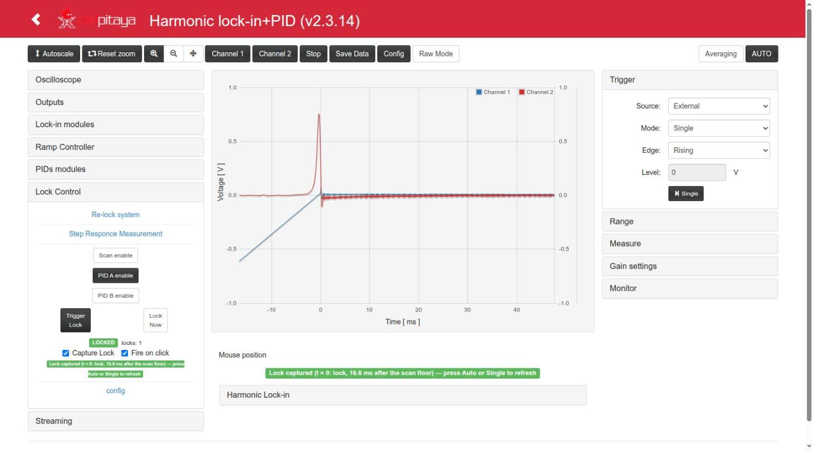

# Red Pitaya Lock-in+PID Application with HARMONIC modulation

This started being a striped version of [lock-in+PID](https://github.com/marceluda/rp_lock-in_pid) project. Now it incorporated some new features that make it another App.

It is an application for the [Red Pitaya STEMlab 125-14](https://www.redpitaya.com/) board (RP): a set of
instruments built in the FPGA (oscilloscope, harmonic lock-in amplifier, two PIDs, ramp generator and
automatic lock control) to measure a system with modulation techniques and stabilize it with a feedback
loop, controlled from a web page or remotely over HTTP.

[](http://www.youtube.com/watch?v=330eYE75MYQ "Fast demosatration of usage")




## Version 2.3.14 (Ecosystem 2.0)

Current version: **2.3.15** (branch `devel2.0`).

This version is **based on the 0.3.x series (v0.3.11), but with the FPGA design built in Vivado 2020.1**,
using the project structure of [RedPitaya-FPGA](https://github.com/RedPitaya/RedPitaya-FPGA).
It is intended for the Red Pitaya **Ecosystem 2.0** (e.g. `RedPitaya_OS_2.04`; tested on 2.04-35).
The 0.3.x series (branch `master`, FPGA with Vivado 2015.2) is the version for the 0.9x / 1.0 ecosystems.

- Web interface and C controller: those of v0.3.11 plus the Ecosystem 2.0 changes of v2.3.10 and the
  fixes of v2.3.12 to v2.3.14 (see [CHANGELOG](CHANGELOG.md))
  (still built with Vivado 2015.2 SDK + Linaro toolchain).
- FPGA: ported to Vivado 2020.1 (see [Building](#building)), oscilloscope of the Ecosystem 2.0 with the
  decimation widened to 20 bits (time ranges up to ~68 s).
- v2.3.13: the lock control runs entirely in the FPGA. `lock_control` (0x18) is command + configuration
  and is never rewritten; the read-only `lock_status` (0x1C, replaces `lock_feedback`) gives armed /
  locked / effective enables / lock count. A lock can be closed from Python writing only registers
  (`py/lock_from_registers.py`). See [lock_in+pid_harmonic/doc/lock_control.md](lock_in+pid_harmonic/doc/lock_control.md).
- v2.3.14: **Capture Lock** (each lock request from the page captures the closing of the loop in the scope,
  triggered by the lock event, and freezes it until Auto / Single) and **Fire on click** (a click with
  *Choose from graph* sets the value and fires Trigger Lock). See
  [lock_in+pid_harmonic/doc/lock_capture.md](lock_in+pid_harmonic/doc/lock_capture.md).


## Features

- Lock-in amplifier
- in-phase and quadrature Demodulation
  - Demodulation for arbitrary phase
  - Demodulatión for double and triple frequency
- Harmonic modulation from 3 Hz to 49.6 kHz, added to the outputs
- Two PID filters, for loop back stabilization
- Ramp/Scan controller for response analysis
- Lock control for automatic scan-stop / PID start (time, level or immediate trigger, run by the FPGA)
- Two-channel oscilloscope on any internal signal, triggered by internal events (scan floor, lock, ...)
- Streaming system for continued acquisition of two channels
- Remote control through HTTP API

**New Interface for lock-in R & Phase** :

[](http://www.youtube.com/watch?v=DzSK8IQkUE4 "New R-phase interphase")

**More decimaion values**

| dec    | max oscilloscope lenght |
|--------|-------------------------|
|      1 |             0.131072 ms |
|      8 |             1.048576 ms |
|     64 |             8.388608 ms |
|    128 |            16.777216 ms |
|    256 |            33.554432 ms |
|    512 |            67.108864 ms |
|   1024 |           134.217728 ms |
|   8192 |           1.073741824 s |
|  65536 |           8.589934592 s |
| 524288 |          68.719476736 s |


## Documentation

| Document | Contents |
|---|---|
| [doc/App.md](doc/App.md) | Instruments and technical data |
| [doc/Usage.md](doc/Usage.md) | Web interface and procedures (scan, lock-in, lock), with screenshots |
| [doc/Structure.md](doc/Structure.md) | Web page ↔ server ↔ FPGA, block diagrams |
| [doc/FPGA.md](doc/FPGA.md) | Register map |
| [doc/Remote.md](doc/Remote.md) | Remote control over HTTP, Python examples |
| [doc/Devel.md](doc/Devel.md) | Building, modifying and testing |
| [CHANGELOG.md](CHANGELOG.md) | Changes by version |

The concepts of the instruments are also explained in the documentation of the original App:
https://marceluda.github.io/rp_lock-in_pid/


## Installation

If you have a RP board you can install the **Lock-in+PID** application
by copying the `lock_in+pid_harmonic` folder (that comes with this tar/zip file) to the
`/opt/redpitaya/www/apps` folder (inside the RP).

The packages are built in `archive/` (`lock_in+pid_harmonic-<version>-<build>-devbuild.{zip,tar.gz}`).
UnZip / UnTar the package and execute from terminal:

```bash
./upload_app.sh rp-XXXXXX.local
```

Replace `rp-XXXXXX.local` by your RP localname or IP address. Also, you can use your own SSH client and
upload the `lock_in+pid_harmonic` folder to the RedPitaya folder `/opt/redpitaya/www/apps` (file system in
read-write mode, `fpga.sh` executable). Then open `http://rp-XXXXXX.local/lock_in+pid_harmonic/`.

For more information about installing procedure, refer to:
https://marceluda.github.io/rp_lock-in_pid/TheApp/install/ and [doc/Devel.md](doc/Devel.md#installing-on-the-board).


## Building

To build or modify the App you need a linux development environment with:
  - Vivado 2015.2 (environment of the C controller / web App build)
  - gcc-linaro-4.9-2015.02-3-x86_64_arm-linux-gnueabihf (installed on `/opt/linaro/gcc-linaro-4.9-2015.02-3-x86_64_arm-linux-gnueabihf/`)
  - Vivado 2020.1 (for the FPGA design, since version 2.3.10), in `/tools/Xilinx/Vivado/2020.1`

The App was based on code from project:
https://github.com/RedPitaya/RedPitaya/tree/release-v0.95/apps-free/scope

Run on terminal:

```bash
source settings.sh
LANG=C make          # controller, c/ tools, FPGA (if changed) and packages in archive/
```

Parts (from the root folder):

```bash
make -C lock_in+pid_harmonic app        # C controller + c/ tools (cross compiled)
make -C lock_in+pid_harmonic c_tools    # only the c/ tools (lock, osc, streaming)
make -C lock_in+pid_harmonic fpga       # FPGA with Vivado 2020.1 (red_pitaya.bit, fpga.bit.bin)
make clean                              # clean all (also: clean_app, clean_fpga in lock_in+pid_harmonic)
```

The FPGA can also be built from `lock_in+pid_harmonic/fpga` (`make`, `make project`, `make clean`); its
Makefile loads Vivado 2020.1 by itself. Requirements, all the targets, tests and details:
[doc/Devel.md](doc/Devel.md).


## License and citation

GPL-3.0 (see [LICENSE](LICENSE)). If you use this software, please cite it (see [CITATION.cff](CITATION.cff)):
M. A. Luda, doi [10.1063/1.5080345](https://doi.org/10.1063/1.5080345).
