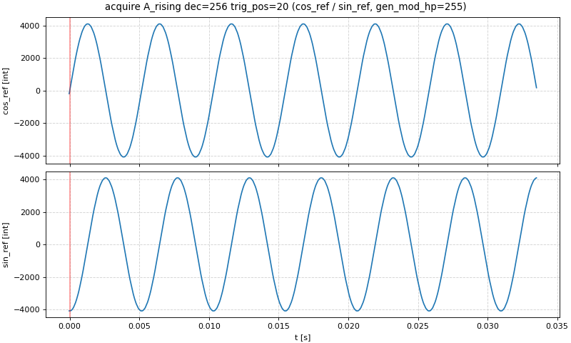
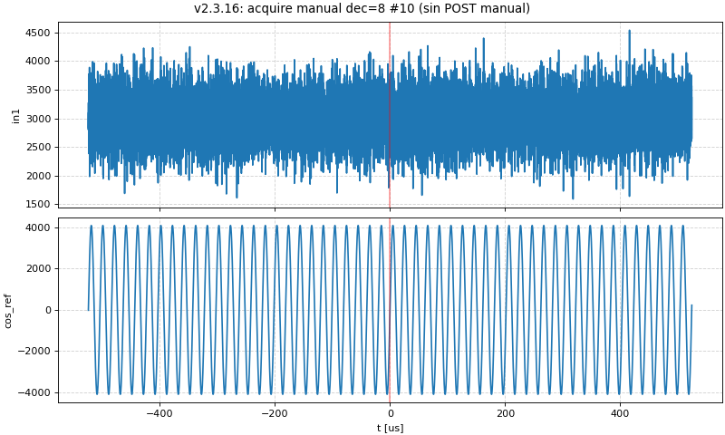

# Remote control

How to control `lock_in+pid_harmonic` **v2.3.17** from a program, without the web page. The registers are
described in [FPGA.md](FPGA.md); the meaning of each instrument in [App.md](App.md).

- [Options](#options)
- [HTTP API](#http-api)
  - [`/lock`: lock module registers](#lock-lock-module-registers)
  - [`/osc`: oscilloscope registers and memory](#osc-oscilloscope-registers-and-memory)
  - [`/data`: the scope of the C controller](#data-the-scope-of-the-c-controller)
  - [Other endpoints](#other-endpoints)
  - [Known issue of the Ecosystem: `POST /data` leaves connections open](#known-issue-of-the-ecosystem-post-data-leaves-connections-open)
- [Python with `requests` only](#python-with-requests-only)
- [Python with `control_finn.py`](#python-with-control_finnpy)
  - [Connection and registers](#connection-and-registers)
  - [Oscilloscope acquisitions](#oscilloscope-acquisitions)
  - [Lock-in, PID, ramp and lock helpers](#lock-in-pid-ramp-and-lock-helpers)
  - [`POST /data` made by each function](#post-data-made-by-each-function)
- [Recipes](#recipes)
  - [Configure the lock-in](#configure-the-lock-in)
  - [Configure a PID and the ramp](#configure-a-pid-and-the-ramp)
  - [Close and check a lock](#close-and-check-a-lock)
  - [Read an oscilloscope acquisition](#read-an-oscilloscope-acquisition)
  - [Streaming](#streaming)
- [Running on the board: `c/` and `py/`](#running-on-the-board-c-and-py)
- [SSH version (deprecated)](#ssh-version-deprecated)
- [Coexistence with the web page](#coexistence-with-the-web-page)

## Options

| Way | Where it runs | Status |
|---|---|---|
| **HTTP API** (`/lock`, `/osc`) + Python (`requests`, `control_finn.py`) | any computer on the network | **recommended** |
| `c/lock`, `c/osc`, `py/*.py` | on the Red Pitaya (SSH) | for scripts on the board, e.g. `py/lock_from_registers.py` |
| SSH version (`resources/remote_control/shh_version`, `control_hugo.py`) | computer, through SSH | deprecated, kept for specific cases |

The web page does not need to be open: the App only has to be **loaded** (FPGA image of this App in the
PL). The App is loaded by opening its page once (or by `http://rp-XXXXXX.local/bazaar?start=lock_in+pid_harmonic`).
Do not use the endpoints while another App is loaded: `c/lock` and `c/osc` access the FPGA addresses
directly.

Since v2.3.15 the whole HTTP remote control (registers, scope acquisitions, PID, ramp, lock-in, lock) works on
Ecosystem 2.0; it was tested on the board with `control_finn.py` and `example_usage.py` in v2.3.15-2.3.17
(`reportes/lock-in_pid_h.md`, sections v2.3.15 to v2.3.17).

## HTTP API

The endpoints are defined in `lock_in+pid_harmonic/nginx.conf` (Lua blocks). Base URL:

```
http://rp-XXXXXX.local/lock_in+pid_harmonic/
```

### `/lock`: lock module registers

`GET /lock_in+pid_harmonic/lock?<query>` runs `/opt/redpitaya/www/apps/lock_in+pid_harmonic/c/lock` with the
query as arguments and returns its output as plain text, one line `name:value` per register:

| Query | Command run | Effect |
|---|---|---|
| (none) | `c/lock` | read all the 99 registers |
| `?in1` or `?in1=` | `c/lock in1` | read `in1` |
| `?aux_A=5` | `c/lock aux_A 5` | write 5 to `aux_A` and read it back |
| `?oscA_sw=12&in1&in2` | `c/lock oscA_sw 12 in1 in2` | several reads and writes (order not guaranteed) |

Rules (from `nginx.conf` and `c/lock.c`):

- Only names matching `[A-Za-z0-9_]+` and **integer** values (`-?[0-9]+`) are passed to the shell; other
  arguments are silently dropped (e.g. `?aux_A=0.5` does nothing). Since v2.3.10 a name without `=` reads.
- The arguments come from a Lua table, so **the order of several arguments in one request is not
  guaranteed**. When the order matters (e.g. the two writes of a lock request) use one request per write.
- Values are decimal. Signed registers accept negative values (two's complement is done by the FPGA).
  Unsigned 32-bit registers accept 0..4294967295 (e.g. `stream_ip`, `lock_trig_time`); a negative value is
  rejected for unsigned registers narrower than 32 bits.
- Errors (answer text, HTTP 200): `ERROR: parameter 'x' not found` (stops at the unknown name),
  `ERROR: <name> is read-only and cannot be written`,
  `ERROR: <name> is not a signed register and you tried to sed value -1`.
- `c/lock` prints signed registers as `int32` and unsigned ones as `uint32`.
- `GET` requests (`/lock`, `/osc`, `/calib`, ...) do not leave open connections on the board (unlike
  `POST /data`, [below](#known-issue-of-the-ecosystem-post-data-leaves-connections-open)).

Example:

```bash
curl "http://rp-XXXXXX.local/lock_in+pid_harmonic/lock?lock_status&lock_control"
# lock_status:4362
# lock_control:1362
```

The register list (name, index, signed, read-only, min, max) is served at
`/lock_in+pid_harmonic/c/lock.txt` (ranges of v2.3.15, see [FPGA.md](FPGA.md#register-description-files-locktxt-osctxt)).

**Reading live signals.** Up to v2.3.16, about 2-3 % of the bus reads of a signal that changes on every clock
(`in1` while it crosses zero, `oscA` showing `in1`) returned 32 bits of garbage (e.g. `0x0118c9c1`), out of the
14-bit range. Averages of `in1` read through `/lock` with an older FPGA must discard impossible values. Since
v2.3.17 (new FPGA image) the reads are exact: 0 bad reads in 8·10⁶ dense reads on the board
(`reportes/lock-in_pid_h.md`, v2.3.17; cause and fix in [FPGA.md](FPGA.md#lock-module-0x40600000)). The value
read is the one of the clock before the read (one more clock of latency, bus reads only).

### `/osc`: oscilloscope registers and memory

`GET /lock_in+pid_harmonic/osc?<query>` runs `c/osc` the same way, on the 21 registers of the scope listed
in `/lock_in+pid_harmonic/c/osc.txt`: `conf`, `TrgSrc`, `ChAth`, `ChBth`, `TrgDelay`, `Dec`, `CurWpt`,
`TrgWpt`, `ChAHys`, `ChBHys`, `AvgEn`, `PreTrgCnt`, `ChAEqFil1..4`, `ChBEqFil1..4` and, since v2.3.15,
**`TrgUnlock`** (index 37, offset `0x94`, write 1; reads 0).

- `?Dec&conf=2`: read `Dec`, write 2 to `conf` (reset of the write state machine).
- `?TrgUnlock=1`: unlock the trigger of the 2.0 scope (see below).
- `?dump`: 16384 lines `:<chA>:<chB>` with the content of both sample buffers (14-bit signed, in buffer
  order, not rotated), followed by the 21 registers `name:value`. The trace starts after the write pointer:
  rotate with `CurWpt` and place t = 0 with `TrgWpt` (see `control_finn.py` `Osc.curv()` and the
  [recipe](#read-an-oscilloscope-acquisition)).

**Triggered acquisition on the 2.0 scope.** The scope of the 2.0 FPGA **locks its trigger after every
trigger** (`TrgSrc` bit 5 reads 1) and ignores new triggers until 1 is written to `TrgUnlock` (0x94,
`rp_scope_cfg.v` l. 227). Up to v2.3.14 `c/osc` could not write it, so an acquisition armed through `/osc`
never triggered again; since v2.3.15 the sequence is the same as the one of the C controller
(`src/fpga.c` `osc_fpga_set_trigger()`, `osc_fpga_triggered()`):

1. `conf=2` (reset), then `Dec`, `TrgDelay` (= 16384 − samples before the trigger), `ChAth`/`ChAHys`, `AvgEn`, ...
2. `conf=1` (arm) and wait for the pre-trigger samples (`samples_before · 8 ns · Dec`).
3. `TrgUnlock=1`, then `TrgSrc=<source>` (1 now, 2/3 ch A rising/falling, 4/5 ch B, 6/7 external = lock trigger).
4. End of the acquisition: `conf` bit 4 = 1 on the 2.0 scope (on the 0.9x scope: `TrgSrc` = 0 and `conf`
   bit 2 = 0). `TrgSrc == 0` alone is not a valid test on 2.0 (bit 5 stays at 1 after the trigger).
5. `?dump`.

Before acquiring, stop the scope of the C controller, otherwise its worker re-arms the same scope with the
`Dec`/`TrgDelay` written by you and the trace mixes both acquisitions (next section).

### `/data`: the scope of the C controller

After `bazaar?start` the C controller (`controllerhf.so`) keeps acquiring in **Auto with no web page
open**, on the same scope. It is stopped by setting its trigger mode to **Single** (`trig_mode` = 2: the
worker resets and configures the scope once and then does not arm it; `src/main.c` `rp_set_params()`,
`src/worker.c`), which is what a Single acquisition of the page does:

```bash
curl -s -X POST -H 'Content-Type: application/json' \
     -d '{"datasets":{"params":{"trig_mode":2}}}' http://rp-XXXXXX.local/data
# {"app":{"id":"lock_in+pid_harmonic"},"datasets":{"params":{..., "trig_mode":2, ...}}}
```

`trig_mode` 0 gives the scope back in Auto, 1 in Normal; `{}` (empty params) only reads. Rules found on the
board (v2.3.16):

- Use **only `POST /data`**. `GET /data` with another 2.0 App loaded crashes the nginx worker; check
  `app.id` in the answer of a POST before acting.
- The `/data` handler of the Ecosystem (nginx module of Red Pitaya) only reads the body that arrives **in the
  same TCP segment as the headers**. `curl` does so; Python `requests` / `http.client` send headers and body
  in two `send()` calls, and ~30 % of their requests got no answer. `control_finn.py` sends the whole request
  in one `send()` (`_post_json_one_send()`, own socket, `Connection: close`, 0.8 s per attempt and 2 retries:
  `DATA_TIMEOUT`, `DATA_RETRIES`).
- Every `POST /data` leaves one open connection on the board: see the next sections.

### Other endpoints

| Endpoint | Answer |
|---|---|
| `/lock_in+pid_harmonic/calib` | output of `/opt/redpitaya/bin/calib -rv` (calibration constants, `NAME = value` lines; on OS 2.04 it prints the v1 names, e.g. `FE_CH1_FS_G_HI = 42949672`, `FE_CH1_DC_offs = 0`, v2.3.15 test) |
| `/lock_in+pid_harmonic/get_ip` | IP of the client |
| `/lock_in+pid_harmonic/streaming` | starts `c/streaming` (see [Streaming](#streaming)); answers `OK` |
| `/lock_in+pid_harmonic/check_streaming` | `0` if `c/streaming` is running, `1` if not |
| `/lock_in+pid_harmonic/restart_server` | restarts the nginx of the board (`systemctl restart redpitaya_nginx`) |

### Known issue of the Ecosystem: `POST /data` leaves connections open

On Ecosystem 2.0 (OS 2.04-35) **every `POST /data` leaves one connection in CLOSE-WAIT** in the nginx worker of
the board: the handler answers `Connection: close` but never closes the socket. It happens with `curl`, Python
and the web page itself; `GET` requests do not leak (measured on RP2, `devAgent.md` problem 55). The worker
has 1024 file descriptors (`worker_connections 1024`), so after about 1000 POST since nginx was (re)started
**the web server of the board stops answering** (also the page and the main menu) until nginx is restarted.
This is not a bug of the App and is not fixed (it should be reported to Red Pitaya, module `ngx_http_rp_module`).

- How many: count them on the board with `ss -tn state close-wait '( sport = :80 )' | tail -n +2 | wc -l`.
  The web page makes one POST per change and 5-9 per Config → load; in the tests 15 config loads raised the
  count by ~100.
- Release them by restarting nginx: `ssh root@rp-XXXXXX.local systemctl restart redpitaya_nginx` (or
  `GET /lock_in+pid_harmonic/restart_server`, which is a GET and does not leak). This unloads the C controller:
  open the page again or call `bazaar?start=lock_in+pid_harmonic`, which **reloads the FPGA image** (registers
  back to their reset values, an active lock is lost). Whether the FPGA (and a running lock) is affected by the
  nginx restart alone, before the `start`, has not been checked: **a confirmar**.
- `control_finn.py` keeps `POST /data` to the minimum ([table](#post-data-made-by-each-function)); `rp.osc.post_count`
  counts the ones made by a script.

## Python with `requests` only

A minimal client for the registers, enough for most scripts (for `POST /data` use `control_finn.py` or
`curl`, see above):

```python
import requests

URL = 'http://rp-XXXXXX.local/lock_in+pid_harmonic'

def lock_get(*names):
    """Read lock registers; returns a dict name -> int."""
    r = requests.get(f'{URL}/lock', params={n: '' for n in names}, timeout=5)
    r.raise_for_status()
    if 'ERROR' in r.text:
        raise ValueError(r.text)
    return {k: int(v) for k, v in (l.split(':') for l in r.text.strip().split('\n'))}

def lock_set(name, value):
    """Write one lock register (integer) and return the value read back."""
    r = requests.get(f'{URL}/lock', params={name: int(value)}, timeout=5)
    r.raise_for_status()
    if 'ERROR' in r.text:
        raise ValueError(r.text)
    return int(r.text.strip().split(':')[1])

print(lock_get('in1', 'in2', 'lock_status'))
lock_set('aux_A', 820)          # 820 counts = 100 mV
```

`requests` resolves the host name in every request; on some PCs a `.local` (mDNS) lookup took up to 3.7 s
from time to time (`reportes/lock-in_pid_h.md`, v2.3.16-2.3.17). For long loops use the IP of the board, or
`control_finn.py`, which resolves the name once.

## Python with `control_finn.py`

`resources/remote_control/http_version/control_finn.py` (Python ≥ 3.8 with `requests`, `numpy` ≥ 1.24 and, for
plots, `matplotlib`; tested with Python 3.11, NumPy 1.26, Matplotlib 3.10) wraps the API. `example_usage.py` in
the same folder runs every feature cell by cell (`#%%` cells for Spyder / VS Code / IPython; the URL can be
given in the environment variable `RP_URL`). Every function has a docstring (`help(rp.acquire)`).

### Connection and registers

```python
from control_finn import RedPitayaApp, reg_labels, WebScopeNotStopped, AcquisitionTimeout

rp = RedPitayaApp('http://rp-XXXXXX.local/lock_in+pid_harmonic/?type=run')   # URL copied from the browser
rp.ip                             # IP used for all the requests (host name resolved once)

rp.lock.aux_A                     # read one register
rp.lock.aux_A = 5                 # write one register (integers only)
rp.lock.oscA_sw = 'cos_ref'       # selectors accept the labels of the UI (reg_labels)
rp.lock.get()                     # dict with all the lock registers
rp.lock.get('in1 in2 error')      # several registers
rp.lock.set({'aux_A': 0, 'aux_B': 0})
rp.osc.get()                      # all the scope registers
```

**Name resolution (v2.3.17).** The host name of the URL (e.g. `rp-XXXXXX.local`) is resolved **once**, when
the object is created (`RedPitayaApp`, or a standalone `Lock(url)` / `Osc(url)`), and every request (the GETs
and the one-send `POST /data`) goes to that IP with the original name in the `Host:` header. On the test PC
the only lookup took 3.7 s, and the following 100 requests 10-21 ms each, with no lookup
(`reportes/lock-in_pid_h.md`, v2.3.17). `rp.ip` is the address in use (`None`: the name is used as is),
`rp.resolve()` resolves it again (e.g. if the board got another IP from DHCP; `rp.resolve_time` is the time it
took), and `RedPitayaApp(url, resolve=False)` keeps the old behaviour (resolved by every request). IPv4 is
preferred; IPv6 only if it is not link-local. If the name can not be resolved there is a warning and the name
is used as before. An object loaded from a `.npy` file does not resolve until `rp.resolve()`.

| Method / attribute | What it does |
|---|---|
| `rp.ip`, `rp.resolve()`, `rp.resolve_time` | IP used for the requests / resolve it again / time of the last resolution |
| `rp.lock.<reg>`, `.get()`, `.set()` | read / write lock registers (names from `c/lock.txt`; labels of `reg_labels`; the old ISR label `'6 us'` is accepted as `'65 us'`) |
| `rp.osc.<reg>`, `.get()`, `.set()` | the same for the scope registers |
| `rp.calib` | constants of `/calib` (used by `curv(raw=False)` and `get_XY()` for `in1`/`in2`; otherwise 8192 counts = 1 V) |
| `rp.save_params()`, `rp.save_last_meas()`, `RedPitayaApp('<file>.npy')`, `rp.load_params()` | save registers (and the last trace) to `.npy`, open it offline, write its read/write registers back |
| `rp.streaming_prepare()`, `.streaming_start()`, `.streaming_stop()` | streaming |
| `HTTP_TIMEOUT` (10 s), `DATA_TIMEOUT` (0.8 s), `DATA_RETRIES` (2) | module constants: timeout of each GET; timeout and retries of `POST /data` |

### Oscilloscope acquisitions

```python
rp.lock.oscA_sw = 'cos_ref'; rp.lock.oscB_sw = 'sin_ref'
tt, ch1, ch2 = rp.acquire('A_rising', dec=256, trig_pos=20)      # measure + wait + curv, volts
tt, ch1, ch2 = rp.acquire('manual', dec=64, trig_pos=0.5, raw=True)
rp.lock.trig_sw = 'Scan floor'
tt, ch1, ch2 = rp.acquire('ext_rising', dec=1024, trig_pos=0.1, timeout=20)   # lock module trigger
rp.plot_meas()
rp.scope_auto()                   # give the scope back to the web page (Auto)
```



| Method | What it does |
|---|---|
| `rp.acquire(trig, dec=1, trig_pos=0.5, threshold=0, hysteresis=63, average=None, timeout=10, raw=False, stop_web_scope=None, check_web_mode=False)` | `measure(wait=True)` + `curv()`: returns `t, ch1, ch2` (t = 0 at the trigger; volts, or counts with `raw=True`) |
| `rp.osc.measure(trig, dec, trig_pos, threshold, hysteresis, average, wait, timeout, stop_web_scope, check_web_mode)` | prepare and arm an acquisition with the [sequence above](#osc-oscilloscope-registers-and-memory). `trig`: `'manual'`, `'A_rising'`, `'A_falling'`, `'B_rising'`, `'B_falling'`, `'ext_rising'`, `'ext_falling'` or 1..7; `dec` 1..1048575 (the page uses up to 524288); `trig_pos` a fraction 0..1 or the number of samples (0..16383) before the trigger |
| `rp.osc.wait(timeout)`, `rp.wait_osc_finish()`, `rp.osc.acq_done()` | wait for / test the end of the acquisition (`conf` bit 4 on 2.0); `AcquisitionTimeout` (also a `ValueError`) on timeout |
| `rp.osc.unlock_trigger()`, `rp.osc.trigger_locked()`, `rp.osc.has_unlock` | write `TrgUnlock` / read `TrgSrc` bit 5 / `c/osc` of the board knows `TrgUnlock` (warns if the App on the board is older than v2.3.15) |
| `rp.osc.dump()`, `rp.osc.curv(data=None, raw=True)` | read the buffers; `curv` returns `t, ch1, ch2` ordered and with t = 0 at the trigger |
| `rp.scope_stop(force=False)`, `rp.scope_auto('auto' \| 'normal')`, `rp.scope_mode()` (also in `rp.osc`) | stop the scope of the C controller (Single) / give it back in Auto or Normal / read its `trig_mode` (0 Auto, 1 Normal, 2 Single, `None`: no answer or another App) |
| `rp.osc.auto_stop_web_scope` (default `True`) | `measure()` / `acquire()` stop the scope of the C controller first |
| `rp.osc.post_count`, `rp.osc.scope_stop_error`, `rp.osc.web_check_reason` | number of `POST /data` attempts / why the last `scope_stop()` failed / why the cached Single was dropped |
| `rp.osc.check_not_overwritten()` | warns if `Dec`/`TrgDelay` changed after `measure()` |
| `rp.plot_meas()` | quick plot of the last trace (or of a saved file) |

**Automatic stop of the web scope (v2.3.16).** `measure()` / `acquire()` call `scope_stop()` first
(`stop_web_scope=None` takes `rp.osc.auto_stop_web_scope`, `True` by default):

1. The first time it asks the controller with `POST /data {}`; if it was not in Single it posts
   `trig_mode` = 2 and waits until the worker has reset the scope (0.25 s, then `conf` bits 0, 2, 4 = 0 and
   `CurWpt` still; at most 3 s). The Single is then remembered.
2. The next calls check it **with `GET /osc` only** (`_web_still_stopped()`): two reads of `conf`, `TrgSrc`,
   `Dec`, `TrgDelay`, `CurWpt`, `TrgWpt` 50 ms apart (`rp.osc.quiet_gap`) must be equal, and equal to the
   values at the end of the last own acquisition. If something changed (the page went back to Auto, a Single
   of the page, ...) the cache is dropped (reason in `web_check_reason`) and it posts again.
3. `scope_stop(force=True)` always asks the controller (1-2 POST).
4. With `wait=True`, after the acquisition the same GET check is repeated and a warning is given if the scope
   changed meanwhile (the data may be mixed). `check_web_mode=True` also asks `trig_mode` with one more POST.

If Single can not be confirmed (no answer after the retries, another App loaded, `trig_mode` not accepted, the
scope keeps running) `measure()` / `acquire()` raise **`WebScopeNotStopped`** (a `RuntimeError`, message =
`rp.osc.scope_stop_error`) **without touching the scope**, instead of acquiring data that could be mixed;
`rp.scope_stop()` called by hand returns `False` with a warning. Then try again, press *Single* in the page,
or acquire anyway with `stop_web_scope=False`. With the page open, `acquire()` puts it in Single (the page
shows *Mode = Single*):


Tested on the board (v2.3.16-30): the first `acquire()` made 2 POST (0.67 s), the next 60 made 0 POST
(0.35-0.40 s each); the page put back in Auto between two acquisitions was detected by the GET check (2 POST,
data not mixed); with an unreachable host `WebScopeNotStopped` came after 2.4 s (3 attempts). Without the stop
(`stop_web_scope=False`, controller in Auto) 3/3 traces were mixed and `check_not_overwritten()` did not warn.



Limits of the checks (docstrings of `check_not_overwritten()` and `_web_still_stopped()`): a worker re-arming
with the same `Dec` / `TrgDelay` as `measure()` is not detected by `check_not_overwritten()` (only the default
stop prevents it); a worker acquiring with a very large decimation may not move `CurWpt` within 50 ms; without
a reference (`measure(wait=False)` and no `wait()`) a re-arm that has already finished with the same
`Dec`/`TrgDelay` is not seen.

### Lock-in, PID, ramp and lock helpers

Added in v2.3.15 (each one writes only the arguments given and returns the resulting state):

| Method | What it does |
|---|---|
| `rp.set_signal(sw)` | lock-in input `signal_sw` (`'in1'`, `'in2'`, `'in1-in2'`, `'cos_ref'`, `'sin_ref'`, `'cos_1f'`, `'aux_A'`, `'Ramp A'`) |
| `rp.get_freq()`, `rp.get_period()`, `rp.set_freq(hp)`, `rp.set_freq_hz(f)` | modulation frequency (`gen_mod_hp` 0..16383; `set_freq_hz` takes the closest value, 3.03 Hz .. 49.603 kHz) |
| `rp.set_phase(val)` | phase of `cos_1f..3f`, 0..2519 (returns degrees) |
| `rp.set_modulation_amplitud(val, ch='out1')` | `mod_out1`/`mod_out2` (−1 off .. 8191; returns the amplitude in V, `val/16384`) |
| `rp.set_lpf(tau_exponent, order, line)`, `rp.get_lpf(line=None)` | low-pass filters: τ = 8 ns·2^tau_exponent (14..29), order 0..2, `line` `'ref'` (X,Y), 1, 2, 3, `'all'` or a list |
| `rp.set_gain(line, amp)` | `sg_amp0..3` (exponent or label `'x32'`; returns the factor) |
| `rp.get_XY(units='V', F=False)` | X, Y (and F1..F3) from the 28-bit registers, read at the same instant (`read_ctrl[0]`). X from `cos_ref` (in phase), Y from `sin_ref` |
| `rp.set_pid(pid='A', sw, sp, kp, ki, kd, PSR, ISR, DSR, SAT, ctrl)`, `rp.get_pid(pid)`, `rp.pid_reset(pid)` | PID A / B (labels accepted: `PSR='/1024'`, `ISR='537 ms'`); `get_pid` adds `in`, `out` and the effective `enabled` from `lock_status`; `pid_reset` pulses the integrator reset |
| `rp.set_ramp(step, low, high, enable, sawtooth, direction, B_factor, reset)`, `rp.get_ramp()` | ramp registers (`step` = `ramp_step`: a **smaller** step is a **faster** ramp) |
| `rp.set_manual(ramp, pidA, pidB)` | manual enables (`lock_control` bits 4:2, the *Scan enable* / *PID A* / *PID B* buttons); a change while LOCKED releases the lock |
| `rp.lock_config(trig='time', time=None, time_ticks=None, level=None, level_V=None, signal=None, rise=True, final=('pidA',), manual=None)` | lock configuration without request: `trig` `'time'`, `'level'`, `'level_time'` or `'off'`; `time` in s (0..34.36 s) or `time_ticks`; `level` in counts or `level_V`; `final` = enables while LOCKED. **Releases an active lock** (writes the request bits as 00) |
| `rp.lock_launch(timeout=None)`, `rp.lock_now()`, `rp.lock_release()` | Trigger Lock (0→1 edge of bit 1; with `timeout` it waits for LOCKED) / Lock Now / release |
| `rp.lock_status()`, `rp.wait_locked(timeout=10)`, `rp.get_lock_control()` | decoded `lock_status` (armed, locked, enables, count) / wait for LOCKED (`AcquisitionTimeout`) / decoded `lock_control` |

### `POST /data` made by each function

Only the scope functions use `POST /data` (one connection each, + 1 per retry when there is no answer); the
register access and all the helpers of the previous table are GET requests.

| Call | `POST /data` |
|---|---|
| `scope_mode()` | 1 |
| `scope_auto()` | 1 |
| `scope_stop()` | 0 while the confirmed Single holds (GET check); otherwise 1 if the controller was already in Single, 2 if it was running. `force=True`: always 1 or 2 |
| `measure()` / `acquire()` | as `scope_stop()` (normally 0 after the first one); + 1 with `check_web_mode=True` (and `wait=True`); 0 with `stop_web_scope=False` |
| everything else | 0 |

`example_usage.py` up to the streaming cell makes about 7 POST.

## Recipes

Values in counts: 8192 counts = 1 V. The examples use `rp` of `control_finn.py`; the register writes behind
each helper are shown where they matter, with the `lock_get` / `lock_set` helpers of the
[`requests`-only client](#python-with-requests-only).

### Configure the lock-in

```python
rp.set_signal('in1')                              # lock-in input (signal_sw = 0)
rp.set_freq(0)                                    # modulation 125e6/2520 = 49.6 kHz (gen_mod_hp = 0)
rp.set_phase(0)                                   # phase of cos_1f..3f (2520 = 360 deg)
rp.set_modulation_amplitud(100, ch='out1')        # add cos_ref with ~50 counts (~6 mV) to OUT1 (mod_out1)
rp.set_lpf(tau_exponent=15, order=2, line='ref')  # X,Y: tau = 8 ns * 2**15 = 262 us (lpf_F0 = 2<<4 | 1)
rp.set_gain('ref', 'x32')                         # Xo, Yo gain x32 (sg_amp0 = 5)
rp.lock.error_sw = 'Yo'                           # error = Yo (error_sw = 2)
rp.lock.error_offset = 0
print(rp.get_XY())                                # X, Y in volts, read at the same instant
```

`get_XY()` freezes the copies with `read_ctrl[0]`; by hand:

```python
lock_set('read_ctrl', 1)                      # freeze the copies
r = lock_get('X_28', 'Y_28')
lock_set('read_ctrl', 0)
X, Y = r['X_28'] / 2**11 / 8192, r['Y_28'] / 2**11 / 8192    # volts, amplitude of each component
```

### Configure a PID and the ramp

```python
rp.set_pid('A', sw='error', sp=0, kp=-500, PSR='/1024',   # kp = -0.488
           ki=-20, ISR='537 ms',                          # tau_i = 537 ms / 20 = 26.8 ms
           kd=0, SAT=13, ctrl=0)                          # integral term limited to +-1 V
rp.lock.out1_sw = 'ctrl_A'                                # OUT1 = PID A + ramp A (out1_sw = 12)

# ramp of the lock_mode test config: triangle +-5000 counts, step 400 -> ~64 ms
rp.set_ramp(step=400, low=-5000, high=5000, sawtooth=False, enable=True)
rp.set_manual(ramp=True, pidA=False, pidB=False)          # "Scan enable": the ramp runs, PIDs off
print(rp.get_pid('A'), rp.get_ramp(), rp.lock_status())
```

Ramp period: `T = (high − low) · (step + 1) · 8 ns · (2 − sawtooth)` ([FPGA.md](FPGA.md#ramp-scan)). With
`step=100, ±4000` (the ramp of `example_usage.py` before v2.3.17) the period is 12.9 ms, shorter than a
16.58 ms time trigger, which then never fires.

### Close and check a lock

The lock control is commanded only with `lock_control` and observed in `lock_status`
([`lock_control.md`](../lock_in+pid_harmonic/doc/lock_control.md) §5). With `control_finn.py`
(the Lock cell of `example_usage.py`, LOCKED in 0.08-0.10 s on the board, v2.3.17):

```python
# time trigger: 16.58 ms after the scan floor (shorter than half the ramp period), PID A on while locked
rp.lock_config(trig='time', time=16.58e-3, final=('pidA',))
st = rp.lock_launch(timeout=10)       # Trigger Lock and wait for LOCKED
print(st)                             # {'armed': False, 'locked': True, 'pidB': False, 'pidA': True, 'ramp': False, 'count': ..., 'raw': ...}

r = rp.lock.get('error_mean error_std')
mean = r['error_mean'] / 2**18
std  = max(r['error_std'] / 32 - mean**2, 0) ** 0.5    # counts (8192 = 1 V)

rp.lock_release()                     # back to the manual enables (scan running)

# level trigger: error crossing 0.1 V upwards
rp.lock_config(trig='level', level_V=0.1, signal='error', rise=True, final=('pidA',))
rp.lock_launch(); rp.wait_locked(timeout=10); rp.lock_release()
```

The same sequence with plain register writes (as `py/lock_from_registers.py`):

```python
import time

def lock_control_value(now=0, launch=0, manual=('ramp',), final=('pidA',), trig_type=1, rise=1):
    bit = {'pidB': 0, 'pidA': 1, 'ramp': 2}
    v = (now & 1) | (launch & 1) << 1
    v |= sum(1 << (2 + bit[x]) for x in manual)     # enables while not locked
    v |= sum(1 << (5 + bit[x]) for x in final)      # enables while locked
    return v | (trig_type & 3) << 8 | (rise & 1) << 10

lock_set('lock_trig_time', round(16.58e-3 / 8e-9))      # 2072500 ticks of 8 ns (0 .. 2**32-1)
# (level trigger instead: lock_trig_sw = 0 (error), lock_trig_val = 5085, trig_type = 2)
base = lock_control_value(trig_type=1)                  # 0x550 = 1360
lock_set('lock_control', base)                          # configuration without request (releases a lock)
lock_set('lock_control', base | 2)                      # arm (Trigger Lock); base | 1 = Lock Now
t0 = time.time()
while not (lock_get('lock_status')['lock_status'] >> 1 & 1) and time.time() - t0 < 10:
    time.sleep(0.01)
lock_set('lock_control', base)                          # release
```

Notes:

- A lock request needs a **0→1 edge** of bit 0 or 1: write the value without the request first. Writing
  the same value again does nothing (so the C controller rewriting registers does not disturb a lock).
- The ramp runs only if `ramp_enable` (0x0B0) is also 1.
- Changing a manual enable (bits 4:2) while LOCKED releases the lock.
- `lock_trig_time` is 32 bits unsigned since v2.3.15 (up to 34.36 s; before, values ≥ 2³¹ aliased). Written
  through `/lock` the value is exact; written from the web page it is rounded to float32 above 2²⁴ ticks
  ([FPGA.md](FPGA.md#lock-control-auto-lock), note on `lock_trig_time`).
- On the board, `python3 py/lock_from_registers.py --trig time --time 16.58ms --set pidA` does the same
  (with `--status`, `--release`, `--now`, `--force`); tested on the board, locked in 0.062 s
  (`reportes/lock-in_pid_h_lock_test/2026-10-08_22:45:40_lock.md` §2.5).

### Read an oscilloscope acquisition

`rp.acquire()` does everything (stop of the web scope, unlock, arm, wait, rotation). By hand, after an
acquisition (yours, or one made by the page, e.g. a Single or a lock capture):

```python
import numpy as np

r = requests.get(f'{URL}/osc', params={'dump': ''}, timeout=10).text.strip().split('\n')
cha = np.array([int(l.split(':')[1]) for l in r if l.count(':') == 2])
chb = np.array([int(l.split(':')[2]) for l in r if l.count(':') == 2])
reg = {l.split(':')[0]: int(l.split(':')[1]) for l in r if l.count(':') == 1}

cur, trg = (reg['CurWpt'] + 1) % 16384, reg['TrgWpt']
cha, chb = np.roll(cha, -cur), np.roll(chb, -cur)       # oldest sample first
t = (np.arange(16384) - (trg - cur) % 16384) * 8e-9 * reg['Dec']   # t = 0 at the trigger
# cha, chb in counts of the signals chosen by oscA_sw / oscB_sw (8192 = 1 V)
```

### Streaming

```python
def ip_to_reg(ip):                         # 'a.b.c.d' -> a + b<<8 + c<<16 + d<<24
    return sum(int(v) << (8 * i) for i, v in enumerate(ip.split('.')))

rp.lock.oscA_sw = 'in1'; rp.lock.oscB_sw = 'error'      # channels to stream
rp.lock.stream_ip = ip_to_reg('192.168.1.10')
rp.lock.stream_port = 6000
rp.lock.stream_rate = 128                               # decimation 128: 0.98 MS/s
rp.streaming_prepare()                                  # start c/streaming on the board (GET /streaming)
rp.streaming_start()                                    # stream_cmd = 1 (a receiver must be listening)
# ...
rp.streaming_stop()                                     # stream_cmd = 0
```

The receiver (`resources/streaming/server`, or `nc -l <port> > file.bin`) and the format of the data are
described in `resources/README.md` (`resources/streaming/read_bin.py` reads the file). The streaming cell of
`example_usage.py` was not part of the v2.3.15-2.3.17 tests (streaming was tested in v2.3.10, [App.md](App.md#streaming)).

## Running on the board: `c/` and `py/`

On the board (`ssh root@rp-XXXXXX.local`), in `/opt/redpitaya/www/apps/lock_in+pid_harmonic/`:

```bash
c/lock                      # all lock registers
c/lock in1 in2 out1 out2    # read some
c/lock oscA_sw 12 in1       # write and read
c/osc                       # scope registers (21, with TrgUnlock)
c/osc dump                  # buffers + registers
python3 py/lock_from_registers.py --status
```

`py/hugo.py` is a Python module with the same register tables (mmap of `/dev/mem`) used by the other
scripts: `lock.py`/`osc.py` (read/write like `c/lock`/`c/osc`), `lock_reg_table.py` (print the table),
`osc_get_ch.py` (read the channels), `osc_trig.py` (triggered acquisition), `data_dump.py` and
`data_dump_file.py` (long acquisitions to a TCP server or to a file), and `lock_from_registers.py`.
`hugo.py` unlocks the 2.0 trigger before writing the source (`start_trigger()`, since v2.3.10), but
`osc_trig.py` waits for `TrgSrc == 0` to detect the end, which is not valid on the 2.0 scope (bit 5 stays at
1, [above](#osc-oscilloscope-registers-and-memory)): it probably ends with "memory read error" (**a confirmar**).
The scripts other than `lock_from_registers.py` have not been re-tested on the 2.0 version (**a confirmar**).
Running them creates `py/__pycache__/` on the board (harmless).

## SSH version (deprecated)

`resources/remote_control/shh_version/` (`control_hugo.py`, `example.py`, `example_streaming.py`,
`config_RP.py`, …) controls the App by running the `py/` scripts on the board through SSH. It predates the
HTTP API and is kept only for specific cases (e.g. long acquisitions written on the board). v2.3.13 fixed
`launch_lock()`/`lock_now()` and added `release_lock()`/`lock_status()` in `control_hugo.py`. New scripts
should use the HTTP API.

## Coexistence with the web page

- The web page and a script can be used at the same time: the page reads the registers on every request
  and shows changes made from outside (e.g. a lock closed from Python), without sending anything back.
- The C controller writes `lock_control` only when the user changes a lock button or checkbox. **The other
  lock registers are rewritten with the controller's copy when the user changes any lock parameter in the
  page**, so a value written from a script can be overwritten by a later change in the page
  (`py/lock_from_registers.py` docstring).
- The scope is shared: `control_finn.py` stops the scope of the controller / page before acquiring
  ([automatic stop](#oscilloscope-acquisitions)) and leaves it in Single; give it back with `rp.scope_auto()`
  or with *Auto* in the page. If the page is put back in Auto during an acquisition, the warning "The scope
  changed after the acquisition" says that the data may be mixed. With the plain HTTP API, stop it yourself
  ([`/data`](#data-the-scope-of-the-c-controller)) or press *Single* in the page.
- Every change made in the page is a `POST /data` and counts for the
  [open connections](#known-issue-of-the-ecosystem-post-data-leaves-connections-open) of nginx.
- Opening the page in a new tab restores that tab's state and sends the transient commands
  (`lock_ctrl_aux_lock_now`, `lock_ctrl_aux_launch_lock_trig`, `lock_stream_cmd`) as 0
  (`index.html` `state_transient_zero`), which **probably releases an active lock** (a confirmar).
