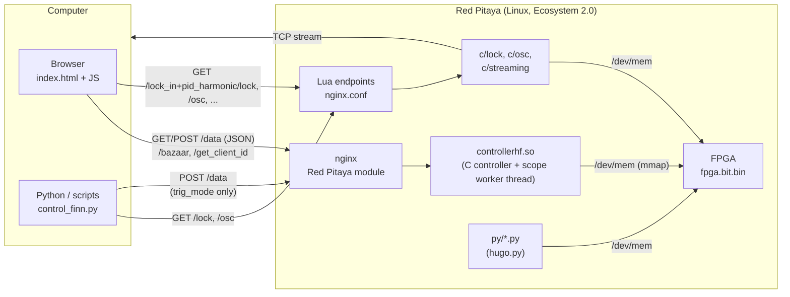
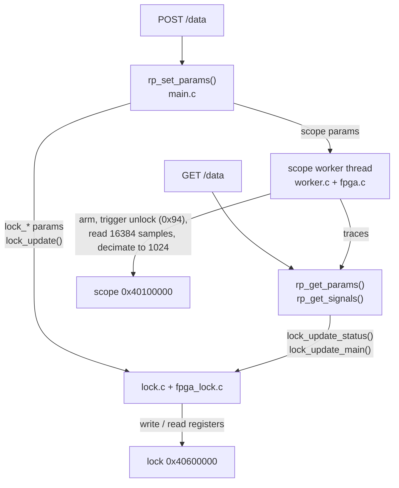
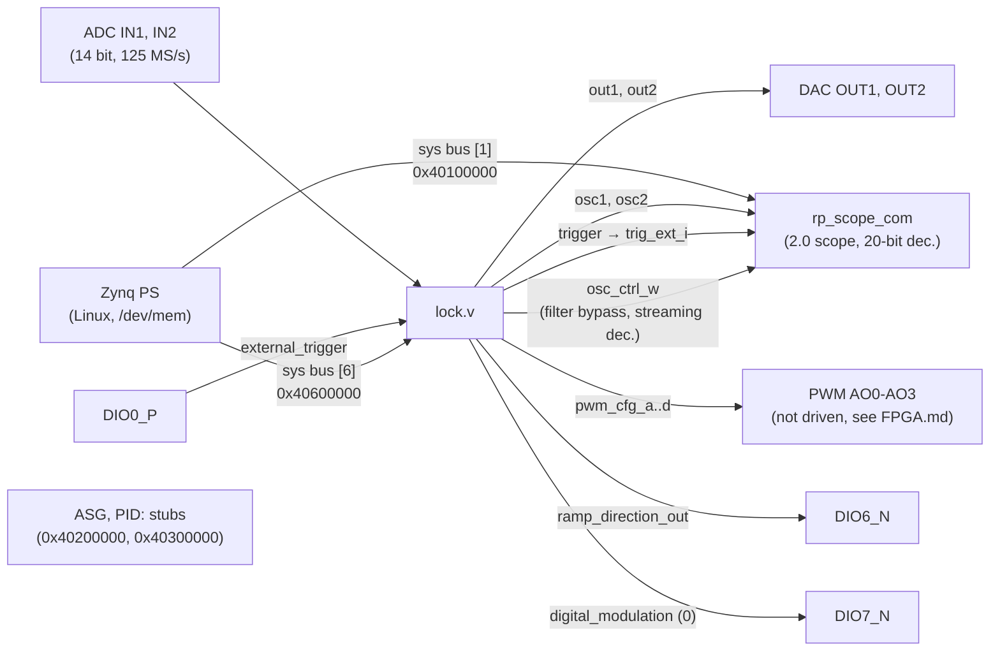
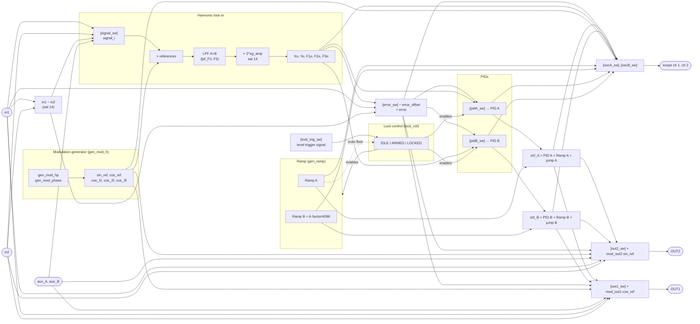
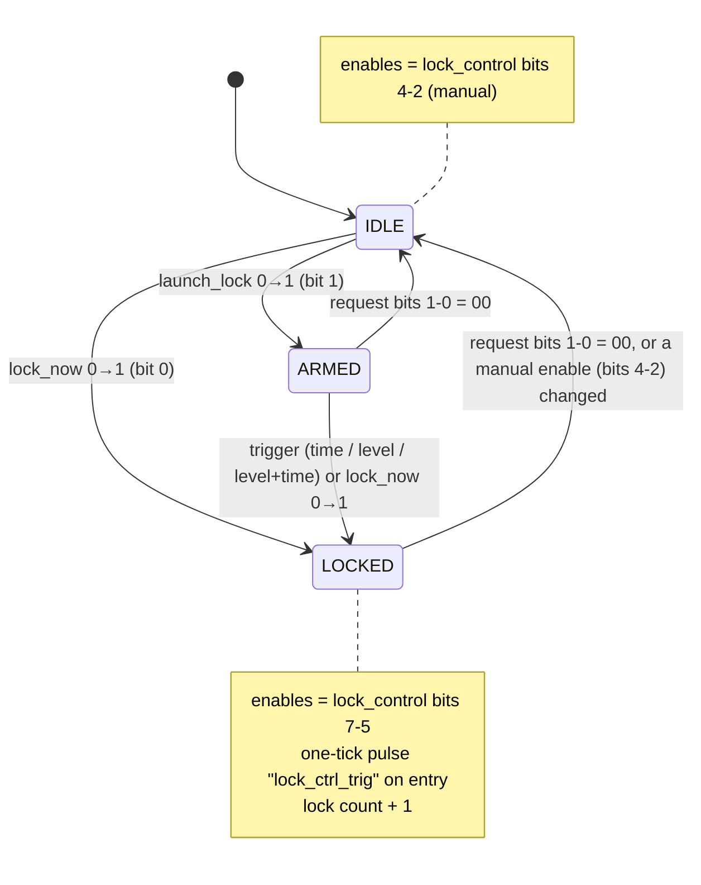
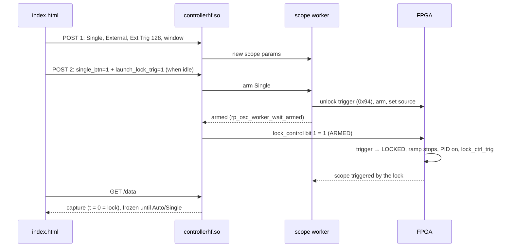

# Internal structure

How `lock_in+pid_harmonic` v2.3.17 is built: the three layers (web page, server, FPGA), how they talk, and
how the instruments are connected inside the FPGA. Registers: [FPGA.md](FPGA.md). Specifications:
[App.md](App.md). Source tree and build: [Devel.md](Devel.md).

- [Layers](#layers)
- [Web page ↔ server](#web-page--server)
- [Server ↔ FPGA: the C controller](#server--fpga-the-c-controller)
- [Inside the FPGA](#inside-the-fpga)
  - [Top level](#top-level)
  - [Signal flow of the lock module](#signal-flow-of-the-lock-module)
  - [Lock control](#lock-control)
  - [Scope and streaming](#scope-and-streaming)
- [Parameters, registers and `config_tool.py`](#parameters-registers-and-config_toolpy)

## Layers

As described for the original [Lock-in+PID](https://marceluda.github.io/rp_lock-in_pid/TheApp/instruments/instruments_01_intro/),
the App has a client-server structure on top of a programmable circuit:

- **Client**: `index.html` (HTML + jQuery + Flot, all in one file) runs in the browser. It polls the
  server, draws the scope and sends parameter changes.
- **Server**: the nginx of the Red Pitaya Ecosystem loads `controllerhf.so` (the App controller) when the
  App is started with `/bazaar?start=lock_in+pid_harmonic`; on Ecosystem 2.0 the FPGA image `fpga.bit.bin`
  is loaded at the start by `fpga.sh` (`fpgautil`). The App also adds its own HTTP endpoints, written in
  Lua inside `nginx.conf`, which run the small C tools of `c/`.
- **Hardware**: the FPGA (`lock.v` and the Red Pitaya scope) does all the real-time processing. The
  software only reads and writes registers; changing a function means changing a register, not the circuit.

## Web page ↔ server

| Endpoint | Method | Who | What |
|---|---|---|---|
| `/bazaar?start=lock_in+pid_harmonic` / `?stop=` | GET | page at start / Restart | start the App (controller + FPGA) / stop the loaded App |
| `/data` | GET | page, polling (~50 ms; 500 ms with a frozen capture) | parameters (JSON `datasets.params`) and the two scope traces (`datasets.signals`, 1024 points) |
| `/data` | POST | page, on each change; `control_finn.py` (`trig_mode` only) | changed parameters only, in chunks of at most 600 bytes, with retries (Ecosystem 2.0 hangs with large bodies). The handler only reads a body that arrives with the headers, and every POST leaves a CLOSE-WAIT connection in nginx ([Remote.md](Remote.md#known-issue-of-the-ecosystem-post-data-leaves-connections-open)) |
| `/get_client_id`, `/set_client_id` | GET/POST | page | claim the board like the factory Apps; detect another client |
| `/lock_in+pid_harmonic/lock?…` | GET | page (streaming IP), Python | run `c/lock`: read/write lock registers ([Remote.md](Remote.md)) |
| `/lock_in+pid_harmonic/osc?…` | GET | Python | run `c/osc`: read/write scope registers (with `TrgUnlock` since v2.3.15), dump the scope memory |
| `/lock_in+pid_harmonic/get_ip` | GET | page (IP button) | IP of the client |
| `/lock_in+pid_harmonic/calib` | GET | Python | output of `calib -rv` (calibration of the board) |
| `/lock_in+pid_harmonic/streaming` | GET | page (Prepare Streaming) | start `c/streaming` detached (`c/stream_start.sh`) |
| `/lock_in+pid_harmonic/check_streaming` | GET | page | 0 if `c/streaming` is running, 1 if not |
| `/lock_in+pid_harmonic/restart_server` | GET | — | `systemctl restart redpitaya_nginx` |
| `/lock_in+pid_harmonic/reload_fpga` | GET | — | 0.9x only; on 2.0 answers HTTP 501 and does not touch the FPGA |

The page keeps three copies of the parameters (`params.orig` from the server, `params.local` edited, the
unsent changes) and sends only what changed. Read-only values (lock-in outputs, `lock_status`, monitor)
are never sent. The page state is saved per tab (`sessionStorage`) and restored after a Restart; configs are
saved in `localStorage` (key `lockConfig_lock_in+pid_harmonic`). A Config → load sends the whole config
(`send_all`, 5-9 chunks) except the time-scale values derived by the server (`send_all_skip`: `forcex_flag`,
`time_units`, `time_range`, `gui_xmin`, `gui_xmax`), and takes the window and units of the answer of the last
chunk (`configLoadApplyX()`, v2.3.17).

## Server ↔ FPGA: the C controller

`src/` builds `controllerhf.so`, the standard interface of a Red Pitaya App (`rp_app_init`,
`rp_app_exit`, `rp_set_params`, `rp_get_params`, `rp_get_signals`):

- **Parameter table**: `src/main.c` `rp_main_params[]` (208 parameters, indices in `src/main.h`): the scope
  (0-41), the AWG and PID of the original scope App (42-80, unused by this FPGA), and the lock module (81-207).
  Most `lock_*` parameters map one to one to a register; some are fields of a register
  (`lock_lpf_F0_tau`/`_order` → `lpf_F0`; `lock_ctrl_aux_*` → `lock_control`; `lock_osc1/2_filt_off` →
  `osc_ctrl`; `lock_pidA_irst/freeze/ifreeze` → `pidA_ctrl`; `lock_rl_*` → `rl_config`; `lock_sf_*` → `sf_config`).
- **`lock_update()`** (`src/lock.c` l. 110) writes the lock registers from the parameters; `lock_control`
  only when the value composed from `lock_ctrl_aux_*` changes (v2.3.13).
- **`lock_update_main()` / `lock_update_status()`** (l. 271, 417) read the registers back (read-only values,
  `lock_status`, and changes made from outside, e.g. Python) into the parameters, on every request.
- **Scope worker** (`src/worker.c`): a thread that arms the scope, waits for the trigger (on 2.0, it unlocks
  the trigger at 0x94 before each acquisition and detects the end with `conf` bit 4), reads both buffers and
  decimates them to 1024 points; it also runs the auto-set (AUTO) and the measurements. Since v2.3.14 a POST
  without scope changes does not reset it, and a lock request that arms a Single waits until the scope is
  armed (`rp_osc_worker_wait_armed()`), which makes *Capture Lock* deterministic
  ([`lock_capture.md`](../lock_in+pid_harmonic/doc/lock_capture.md) §3.2).
- **`trig_mode` = 2 (Single)** puts the worker in its idle state: it resets and configures the scope once and
  then does not arm it (`src/main.c` `rp_set_params()`, `src/worker.c`). After `bazaar?start` the worker runs in
  Auto even with no page open; `control_finn.py` sets Single through `POST /data` before acquiring through
  `/osc` (v2.3.16, [Remote.md](Remote.md#oscilloscope-acquisitions)).

## Inside the FPGA

### Top level

`fpga/prj/v0.94/rtl/red_pitaya_top.sv` (RedPitaya-FPGA v0.94 adapted to behave like the 2015.2 design
of the App):

The DACs are driven only by the lock module and the scope only sees the two signals chosen inside it
(`oscA_sw`, `oscB_sw`), never the raw ADC.

### Signal flow of the lock module

`fpga/prj/v0.94/rtl/lock.v` and `lock/*.v`. Selectors are drawn as `[sel]` with the register name; the
values of each selector are in [FPGA.md](FPGA.md#selector-values). This is the "instruments" view of the
published documentation, applied to this App.

Main points (with the lines of `lock.v`):

- **Lock-in** (l. 707-902): `signal_i` is multiplied by the five references (DSP multipliers), filtered by two
  cascaded first-order low-pass filters per line (A and B, `LP_filter3`), scaled by 2^`sg_amp` and saturated
  to 14 bits. X and Y use `cos_ref` and `sin_ref` with 38-bit paths (10 more bits of resolution) and share
  `lpf_F0`/`sg_amp0`; F1, F2 and F3 use `cos_1f`, `cos_2f`, `cos_3f` and have their own filter and gain.
- **Error** (l. 538-563): one of 0, Xo, Yo, F1o, F2o, F3o, in1, in1−in2, minus `error_offset`; its mean and
  square are accumulated over 2²⁷ ticks for the Monitor.
- **PIDs** (l. 907-997): each PID takes a signal (`pidX_sw`), computes P, I, D (`lock_pid_block.v`) and its
  output is forced to 0 (and the integrator reset) when the lock control disables it.
- **Control signals** (l. 275-282): `ctrl_A = pidA_out + ramp_A + jumpA`, `ctrl_B = pidB_out + ramp_B + jumpB`,
  saturated.
- **Outputs** (l. 373-431): any of 16 signals, plus the modulation (`mod_out1·cos_ref`, `mod_out2·sin_ref`)
  when `mod_outX ≥ 0`, saturated.
- **Scope** (l. 287-345): two 25-input selectors; external trigger from `trig_sw` (l. 348-368).
- **Bus interface** (`[FPGA MEMORY DOCK]`, l. 1004-1305): registers written by the PS and the read
  multiplexer. Since v2.3.17 the read-only signals are read from registered copies (`*_rd`, l. 850-881) and
  `sys_rdata` is loaded only during a read and then held, because the PS side of the bus (`sys_bus_cdc`) takes it
  asynchronously some cycles later; the copies are not used by the real-time loop
  ([FPGA.md](FPGA.md#lock-module-0x40600000)).

### Lock control

The state machine of `lock/lock_ctrl.v`, configured and commanded by `lock_control` and observed in
`lock_status`. Full description: [`lock_control.md`](../lock_in+pid_harmonic/doc/lock_control.md).

The time trigger counts ticks from the last scan floor of the ramp (`ramp_floor_trig`); the level trigger
watches the signal selected by `lock_trig_sw`. On entering LOCKED the FPGA emits `lock_ctrl_trig`, which is
bit 7 of `trig_sw` ("Lock control trig"): the web page arms a Single acquisition on it to capture the lock
(*Capture Lock*, [`lock_capture.md`](../lock_in+pid_harmonic/doc/lock_capture.md)).

The sequence of a lock request from the page with Capture Lock:

Times measured on the board: POST 2 → ARMED 17 ms, ARMED → LOCKED 16.9 ms (first sweep).

### Scope and streaming

- The scope (`fpga/rtl/rtl/classic/rp_scope_com.v`) samples `osc1`/`osc2` of the lock module, with a
  20-bit decimation. `osc_ctrl_w` of the lock module can bypass the equalization filters and, while
  streaming, impose the decimation `stream_rate` (`rp_scope_com.v` l. 194-207).
- Streaming: `c/streaming` waits for `stream_cmd = 1`, then `c/stream_tcp_osc_cmd` reads the circular
  buffers of the scope following the write pointer and sends the samples over TCP. The web page must not
  read the scope meanwhile (the worker leaves the scope alone while `stream_cmd = 1`).

## Parameters, registers and `config_tool.py`

The same register list exists in several places: `lock.v` (registers and bus decoder), `src/fpga_lock.h`
(C struct), `src/lock.c` (writes/reads), `src/main.c`/`main.h` (parameters), `index.html` (fields and
selectors), `c/lock.c` / `c/osc.c` and `c/lock.txt` / `c/osc.txt` (tools), `py/hugo.py`.
`resources/config_tool.py` holds the table and regenerates the blocks marked by "docks" in those files
(`// [WIREREG DOCK]`, `// [FPGA MEMORY DOCK]`, `// [LOCKREGS DOCK]`, `[MAINDEFH DOCK]`, …). See
[Devel.md](Devel.md#registers-and-config_toolpy).
