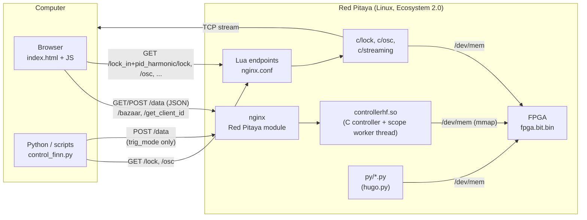
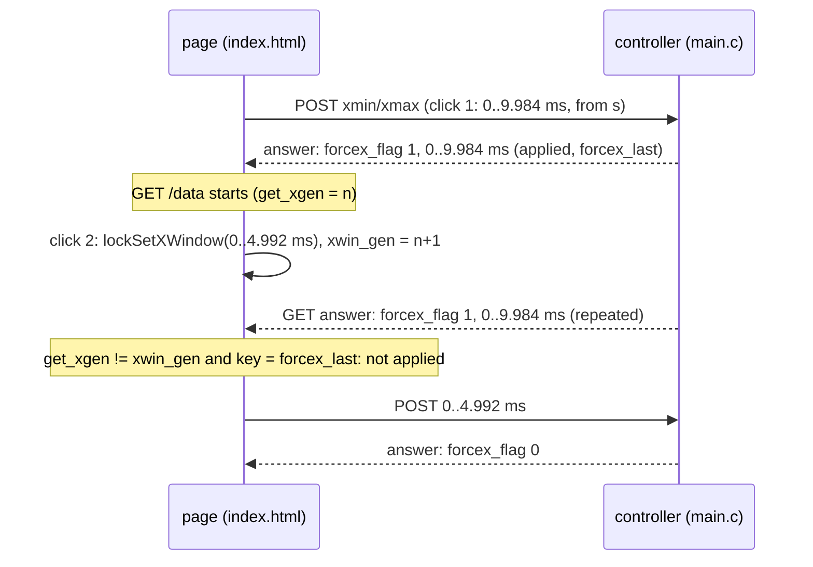
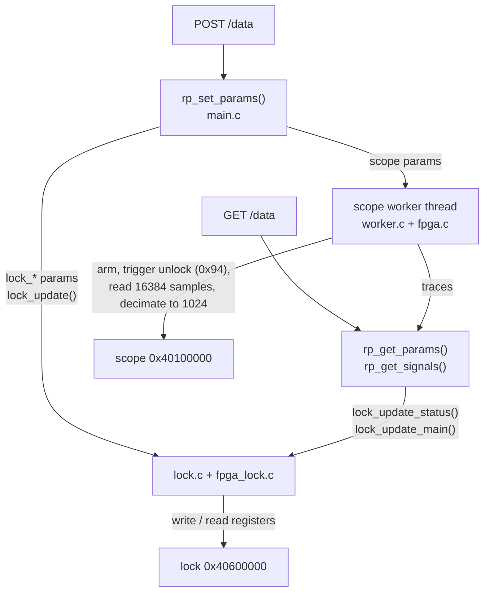
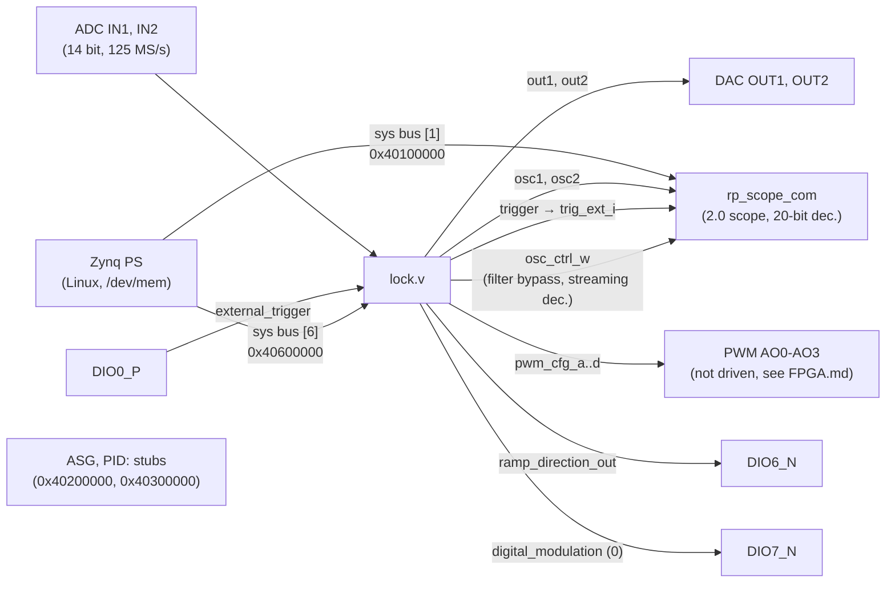
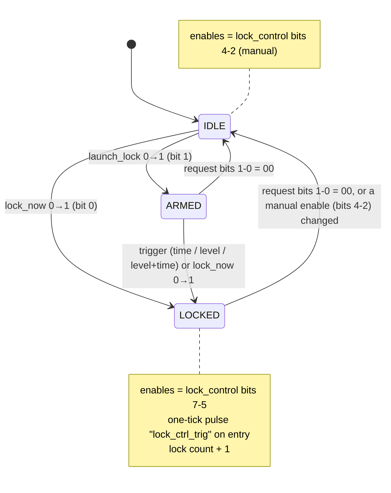
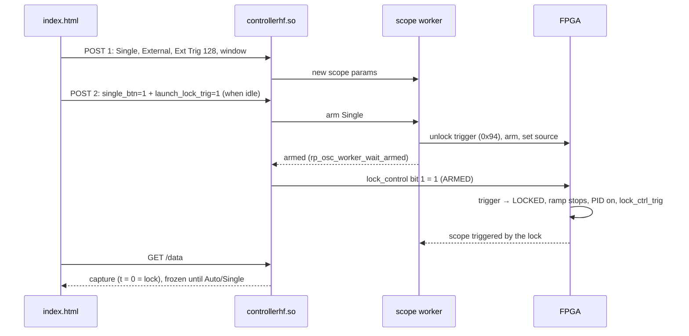

# Internal structure

How `lock_in+pid_harmonic` v2.3.31 (branch `master`) is built: the three layers (web page, server, FPGA), how they talk, and
how the instruments are connected inside the FPGA. Registers: [FPGA.md](FPGA.md). Specifications:
[App.md](App.md). Source tree and build: [Devel.md](Devel.md).

- [Layers](#layers)
- [Web page ↔ server](#web-page--server)
  - [Time window of the plot and Force X](#time-window-of-the-plot-and-force-x)
- [Server ↔ FPGA: the C controller](#server--fpga-the-c-controller)
- [Inside the FPGA](#inside-the-fpga)
  - [Top level](#top-level)
  - [Signal flow of the lock module](#signal-flow-of-the-lock-module)
  - [Lock control](#lock-control)
  - [Scope and streaming](#scope-and-streaming)
- [Parameters, registers and `config_tool.py`](#parameters-registers-and-config_toolpy)

## Layers

As described for the original [Lock-in+PID](https://marceluda.github.io/rp_lock-in_pid/TheApp/instruments/instruments_01_intro/),
the App has a client-server structure on top of a programmable circuit:

- **Client**: `index.html` (HTML + jQuery + Flot, all in one file) runs in the browser. It polls the
  server, draws the scope and sends parameter changes.
- **Server**: the nginx of the Red Pitaya Ecosystem loads `controllerhf.so` (the App controller) when the
  App is started with `/bazaar?start=lock_in+pid_harmonic`; on Ecosystem 2.0 the FPGA image `fpga.bit.bin`
  is loaded at the start by `fpga.sh` (`fpgautil`). The App also adds its own HTTP endpoints, written in
  Lua inside `nginx.conf`, which run the small C tools of `c/`.
- **Hardware**: the FPGA (`lock.v` and the Red Pitaya scope) does all the real-time processing. The
  software only reads and writes registers; changing a function means changing a register, not the circuit.

## Web page ↔ server

| Endpoint | Method | Who | What |
|---|---|---|---|
| `/bazaar?start=lock_in+pid_harmonic` / `?stop=` | GET | page at start / Restart | start the App (controller + FPGA) / stop the loaded App |
| `/data` | GET | page, polling (~50 ms; 500 ms with a frozen capture) | parameters (JSON `datasets.params`) and the two scope traces (`datasets.signals`, 1024 points) |
| `/data` | POST | page, on each change; `control_finn.py` (`trig_mode` only) | changed parameters only, in chunks of at most 600 bytes, with retries (Ecosystem 2.0 hangs with large bodies). The handler only reads a body that arrives with the headers, and every POST leaves a CLOSE-WAIT connection in nginx ([Remote.md](Remote.md#known-issue-of-the-ecosystem-post-data-leaves-connections-open)) |
| `/get_client_id`, `/set_client_id` | GET/POST | page | claim the board like the factory Apps; detect another client |
| `/lock_in+pid_harmonic/lock?…` | GET | page (streaming IP), Python | run `c/lock`: read/write lock registers ([Remote.md](Remote.md)) |
| `/lock_in+pid_harmonic/osc?…` | GET | Python | run `c/osc`: read/write scope registers (with `TrgUnlock` since v2.3.15), dump the scope memory |
| `/lock_in+pid_harmonic/get_ip` | GET | page (IP button) | IP of the client |
| `/lock_in+pid_harmonic/calib` | GET | Python | output of `calib -rv` (calibration of the board) |
| `/lock_in+pid_harmonic/streaming` | GET | page (Prepare Streaming) | start `c/streaming` detached (`c/stream_start.sh`) |
| `/lock_in+pid_harmonic/check_streaming` | GET | page | 0 if `c/streaming` is running, 1 if not |
| `/lock_in+pid_harmonic/restart_server` | GET | — | `systemctl restart redpitaya_nginx` |
| `/lock_in+pid_harmonic/reload_fpga` | GET | — | 0.9x only; on 2.0 answers HTTP 501 and does not touch the FPGA |

The page keeps three copies of the parameters (`params.orig` from the server, `params.local` edited, the
unsent changes) and sends only what changed. Read-only values (lock-in outputs, `lock_status`, monitor)
are never sent. The page state is saved per tab (`sessionStorage`) and restored after a Restart; configs are
saved in `localStorage` (key `lockConfig_lock_in+pid_harmonic`). A Config → load sends the whole config
(`send_all`, 5-9 chunks) except the time-scale values derived by the server (`send_all_skip`: `forcex_flag`,
`time_units`, `time_range`, `gui_xmin`, `gui_xmax`), and takes the window and units of the answer of the last
chunk (`configLoadApplyX()`, v2.3.17).

Ramp Controller (v2.3.31, page only, ported from `lock_in+pid_plus` 2.2.0): the tabs *period* / *freq* and *Lock osc.
screen* are the `[RAMP CALC]` (pure functions: period, frequency, f → step, amplitude / offset ↔ limits, zoom → limits;
also run by `test/ramp_ui_sim.js`) and `[RAMP UI]` blocks of `index.html` (l. 3405-3631 and 3633-3943; the period of the
ramp, `rampPeriodCycles()`, is in `[TRIG FROM GRAPH]`, l. 3208, and the windows of *Reset zoom* / *Lock osc. screen*,
`resetZoomWindow()` and the whole / half cycle `resetZoomCycleNext()`, in `[RESET ZOOM]`, l. 3293-3403). They only
write the existing parameters `lock_ramp_step`, `lock_ramp_low_lim`, `lock_ramp_hig_lim` (one POST) and, for *Lock osc.
screen*, the scope parameters `trig_source`, `trig_mode`, `lock_trig_sw` and the time window (`xmin` / `xmax`), as
*Reset zoom* does. Their state (active tab in `localStorage` key `lockin_ramp_tab_lock_in+pid_harmonic`, l. 3642;
`ramp_ls`, `ramp_f_nominal`) is not part of the parameters nor of the configs. No change in the controller nor in the
FPGA ([Usage.md](Usage.md#ramp-controller)). The *Ramp period* field is a text field whose parser is in
`input_unit_parsers` (l. 2461-2464, `rampStepParseField()` → `rampParseStep()`), like the *Time trigger* / *Level
trigger* fields.

### Time window of the plot and Force X

The time window of the scope is a pair of parameters, `xmin` / `xmax`, in the **time units** of the server
(`time_units`: 0 µs, 1 ms, 2 s), which follow the decimation (`time_range`) that the controller chooses for the window
(`transform_acq_params()`, `src/main.c` l. 656). When a POST changes the units (e.g. a window of 0 … 2 s followed by a
*Reset zoom* to 0 … 9.984 ms), the controller converts the window to the new units and raises **`forcex_flag`**
(`src/main.c` l. 103-108, set at l. 800-818): the page must put its X axis on the `xmin` / `xmax` of the server. The
flag stays 1 in the answer of that POST **and in every `GET /data`** until the page sends the next POST: one that
only sends the window back (`rp_set_params()`, l. 995-998), or a scope change whose window is within a factor 33 of
the forced one or comes more than 1.5 s after it (`FORCEX_STALE_MS`, l. 470, 700-702).

Up to v2.3.30 the page applied the forceX of every GET. A GET that was in flight when the page set a new window
(the second click of *Reset zoom*, 0 … T/2) brought ~70 ms later the window of the first click; and the repeated flag
undid a wheel / box zoom made from t = 0 during the 250 ms before its POST (found on `lock_in+pid_plus` 2.2.0-rc3,
2 of 4 tries). Since **v2.3.31** the `[FORCEX]` block (`index.html` l. 325-352) filters it:

| Piece | Where | What it does |
|---|---|---|
| `xwin_gen` / `xWindowLocal()` | l. 339-341 | counter of "the page touched the X window": +1 in `lockSetXWindow()` (l. 4022-4023, used by Reset zoom, Lock osc. screen, Capture Lock), `xWindowToParams()` (l. 5086-5087), X± (l. 546), the X offset buttons (l. 615), the X zoom of the wheel (l. 5135), and at the start (l. 5896) and at the answer (l. 5919) of every POST |
| `get_xgen` | l. 4786 | value of `xwin_gen` when a `GET /data` starts (as `get_epoch` = `plot_epoch` for the data, v2.3.23) |
| `getForceXApply(p, get_epoch, get_xgen)` | l. 344-351, used at l. 4885 | the forceX of a GET answer is applied only if `forcex_flag` = 1, the GET started after the last Reset zoom was answered (`get_epoch === plot_epoch`), nothing touched the X window nor sent / got a POST since the GET started (`get_xgen === xwin_gen`), and its window (`xmin`, `xmax`, `time_units`: `forceXKey()`) is not the one of the last forceX applied |
| `forcex_last` | l. 340; set at l. 5946 | the forceX of a POST answer is applied as before and remembered, so the GETs that repeat it do not apply it again |

`plot_epoch` alone (v2.3.23) was not enough: it moves only with Reset zoom and Lock osc. screen, not with the box,
the wheel or X±. A forceX that is not stale (e.g. another client sets 0 … 2 s and the units change) still reaches
the page, once. Checked by `test/forcex_race_sim.js` (7/7; with `--old` on v2.3.30: 4/6) and on RP2 (report
`reportes/lock-in_pid_h/2026-11-13_1439_v2331.md`: 10/10 second clicks from an axis in seconds stayed at 0 … T/2 also
6 s later; a SHIFT + wheel zoom from t = 0 and a box from the left edge right after a forceX stayed 6 s). No change in
the controller.

## Server ↔ FPGA: the C controller

`src/` builds `controllerhf.so`, the standard interface of a Red Pitaya App (`rp_app_init`,
`rp_app_exit`, `rp_set_params`, `rp_get_params`, `rp_get_signals`):

- **Parameter table**: `src/main.c` `rp_main_params[]` (212 parameters, `PARAMS_NUM`, indices in `src/main.h`): the
  scope (0-41), the AWG and PID of the original scope App (42-80, unused by this FPGA), the lock module (81-207)
  and, since v2.3.23, four read-only scope state parameters (208-211: `scope_gen`, `scope_acq_state`,
  `scope_acq_gen`, `sig_gen`; `src/main.h` l. 278-281) that tell the page which acquisition a trace comes from.
  Most `lock_*` parameters map one to one to a register; some are fields of a register
  (`lock_lpf_F0_tau`/`_order` → `lpf_F0`; `lock_ctrl_aux_*` → `lock_control`; `lock_osc1/2_filt_off` →
  `osc_ctrl`; `lock_pidA_irst/freeze/ifreeze` → `pidA_ctrl`; `lock_rl_*` → `rl_config`; `lock_sf_*` → `sf_config`).
- **`lock_update()`** (`src/lock.c` l. 221) writes the lock registers from the parameters; `lock_control`
  only when the value composed from `lock_ctrl_aux_*` changes (v2.3.13).
- **`lock_update_main()` / `lock_update_status()`** (l. 391, 538) read the registers back (read-only values,
  `lock_status`, and changes made from outside, e.g. Python) into the parameters, on every request.
- **Scope worker** (`src/worker.c`): a thread that arms the scope, waits for the trigger (on 2.0, it unlocks
  the trigger at 0x94 before each acquisition and detects the end with `conf` bit 4), reads both buffers and
  decimates them to 1024 points; it also runs the auto-set (AUTO) and the measurements. Since v2.3.14 a POST
  without scope changes does not reset it. Since v2.3.23 every point is a sample counted from the trigger and is
  read only if it was written in the current acquisition (windows ≥ 1.5 s are read while being written, and
  partial traces are served); and a lock request that arms a Single no longer waits in the POST: the request bits
  are held out of `lock_control` (`lock_request_hold()` and the `lock_ctrl_hold*` state, `src/lock.c` l. 75-80
  and 604) until the worker has enabled the trigger of that acquisition, which keeps *Capture Lock* deterministic
  also with slow scans ([`lock_capture.md`](../lock_in+pid_harmonic/doc/lock_capture.md), section "v2.3.23: slow
  scans").
- **`trig_mode` = 2 (Single)** puts the worker in its idle state: it resets and configures the scope once and
  then does not arm it (`src/main.c` `rp_set_params()`, `src/worker.c`). After `bazaar?start` the worker runs in
  Auto even with no page open; `control_finn.py` sets Single through `POST /data` before acquiring through
  `/osc` (v2.3.16, [Remote.md](Remote.md#oscilloscope-acquisitions)).

## Inside the FPGA

### Top level

`fpga/prj/v0.94/rtl/red_pitaya_top.sv` (RedPitaya-FPGA v0.94 adapted to behave like the 2015.2 design
of the App):

The DACs are driven only by the lock module and the scope only sees the two signals chosen inside it
(`oscA_sw`, `oscB_sw`), never the raw ADC.

### Signal flow of the lock module

`fpga/prj/v0.94/rtl/lock.v` and `lock/*.v`. Selectors are drawn as `[sel]` with the register name; the
values of each selector are in [FPGA.md](FPGA.md#selector-values). This is the "instruments" view of the
published documentation, applied to this App.

```mermaid
flowchart LR
  IN1([in1]) & IN2([in2]) --> SUB["in1 − in2<br/>(sat 14)"]

  subgraph GEN["Modulation generator (gen_mod_h)"]
    HP["gen_mod_hp<br/>gen_mod_phase"] --> REF["sin_ref, cos_ref<br/>cos_1f, cos_2f, cos_3f"]
  end

  subgraph LI["Harmonic lock-in"]
    SIG["[signal_sw]<br/>signal_i"] --> MUL["× references"] --> LPF["LPF A+B<br/>(lpf_F0..F3)"] --> AMP["× 2^sg_amp<br/>sat 14"]
    AMP --> XY["Xo, Yo, F1o, F2o, F3o"]
  end

  IN1 & IN2 & SUB & AUX([aux_A, aux_B]) --> SIG
  REF --> MUL

  XY --> ERR["[error_sw] − error_offset<br/>= error"]
  IN1 & SUB --> ERR

  subgraph PIDS["PIDs"]
    PA["[pidA_sw] → PID A"]
    PB["[pidB_sw] → PID B"]
  end
  ERR --> PA & PB
  XY --> PA & PB

  subgraph RAMP["Ramp (gen_ramp)"]
    RA["Ramp A"]
    RB["Ramp B = A·factor/4096"]
  end

  subgraph LC["Lock control (lock_ctrl)"]
    SM["IDLE / ARMED / LOCKED"]
  end
  LTS["[lock_trig_sw]<br/>level trigger signal"] --> SM
  RA -. "scan floor" .-> SM
  SM -- "enables" --> RAMP
  SM -- "enables" --> PA & PB

  PA --> CA["ctrl_A = PID A + Ramp A + jump A"]
  RA --> CA
  PB --> CB["ctrl_B = PID B + Ramp B + jump B"]
  RB --> CB

  CA & CB & ERR & REF & AUX & IN1 & IN2 --> O1["[out1_sw] + mod_out1·cos_ref"] --> OUT1([OUT1])
  CA & CB & ERR & REF & AUX & IN1 & IN2 --> O2["[out2_sw] + mod_out2·sin_ref"] --> OUT2([OUT2])

  CA & CB & ERR & XY & REF & RA & RB & PA & PB --> SC["[oscA_sw], [oscB_sw]"] --> OSC([scope ch 1, ch 2])
```

Main points (with the lines of `lock.v`):

- **Lock-in** (l. 725-908): `signal_i` is multiplied by the five references (DSP multipliers), filtered by two
  cascaded first-order low-pass filters per line (A and B, `LP_filter3`), scaled by $2^{\mathrm{sg\_amp}}$ and saturated
  to 14 bits. X and Y use `cos_ref` and `sin_ref` with 38-bit paths (10 more bits of resolution) and share
  `lpf_F0`/`sg_amp0`; F1, F2 and F3 use `cos_1f`, `cos_2f`, `cos_3f` and have their own filter and gain.
- **Error** (l. 555-580): one of 0, Xo, Yo, F1o, F2o, F3o, in1, in1−in2, minus `error_offset`; its mean and
  square are accumulated over $2^{27}$ ticks for the Monitor.
- **PIDs** (l. 913-1007): each PID takes a signal (`pidX_sw`), computes P, I, D (`lock_pid_block.v`) and its
  output is forced to 0 (and the integrator reset) when the lock control disables it.
- **Control signals** (l. 279-286): `ctrl_A = pidA_out + ramp_A + jumpA`, `ctrl_B = pidB_out + ramp_B + jumpB`,
  saturated.
- **Outputs** (l. 377-448): any of 16 signals, plus the modulation (`mod_out1·cos_ref`, `mod_out2·sin_ref`)
  when `mod_outX ≥ 0`, saturated.
- **Scope** (l. 291-349): two 25-input selectors; external trigger from `trig_sw` (l. 352-372).
- **Bus interface** (`[FPGA MEMORY DOCK]`, l. 1014-1315): registers written by the PS and the read
  multiplexer. Since v2.3.17 the read-only signals are read from registered copies (`*_rd`, l. 873-904) and
  `sys_rdata` is loaded only during a read and then held, because the PS side of the bus (`sys_bus_cdc`) takes it
  asynchronously some cycles later; the copies are not used by the real-time loop
  ([FPGA.md](FPGA.md#lock-module-0x40600000)).

### Lock control

The state machine of `lock/lock_ctrl.v`, configured and commanded by `lock_control` and observed in
`lock_status`. Full description: [`lock_control.md`](../lock_in+pid_harmonic/doc/lock_control.md).

The time trigger counts ticks from the last scan floor of the ramp (`ramp_floor_trig`); the level trigger
watches the signal selected by `lock_trig_sw`. On entering LOCKED the FPGA emits `lock_ctrl_trig`, which is
bit 7 of `trig_sw` ("Lock control trig"): the web page arms a Single acquisition on it to capture the lock
(*Capture Lock*, [`lock_capture.md`](../lock_in+pid_harmonic/doc/lock_capture.md)).

The sequence of a lock request from the page with Capture Lock:

Times measured on the board: POST 2 → ARMED 17 ms, ARMED → LOCKED 16.9 ms (first sweep).

### Scope and streaming

- The scope (`fpga/rtl/rtl/classic/rp_scope_com.v`) samples `osc1`/`osc2` of the lock module, with a
  20-bit decimation. `osc_ctrl_w` of the lock module can bypass the equalization filters and, while
  streaming, impose the decimation `stream_rate` (`rp_scope_com.v` l. 194-207).
- Streaming: `c/streaming` waits for `stream_cmd = 1`, then `c/stream_tcp_osc_cmd` reads the circular
  buffers of the scope following the write pointer and sends the samples over TCP. The web page must not
  read the scope meanwhile (the worker leaves the scope alone while `stream_cmd = 1`).

## Parameters, registers and `config_tool.py`

The same register list exists in several places: `lock.v` (registers and bus decoder), `src/fpga_lock.h`
(C struct), `src/lock.c` (writes/reads), `src/main.c`/`main.h` (parameters), `index.html` (fields and
selectors), `c/lock.c` / `c/osc.c` and `c/lock.txt` / `c/osc.txt` (tools), `py/hugo.py`.
`resources/config_tool.py` holds the table and regenerates the blocks marked by "docks" in those files
(`// [WIREREG DOCK]`, `// [FPGA MEMORY DOCK]`, `// [LOCKREGS DOCK]`, `[MAINDEFH DOCK]`, …). See
[Devel.md](Devel.md#registers-and-config_toolpy).
