# Using the App from the web interface

How to use `lock_in+pid_harmonic` **v2.3.24** from the browser, panel by panel, and the usual procedures:
scan, see a peak, get an error signal with the lock-in, close a lock and check it. Technical data of each
instrument is in [App.md](App.md); registers in [FPGA.md](FPGA.md).

- [Opening the App](#opening-the-app)
- [Layout of the page](#layout-of-the-page)
- [Panels](#panels)
  - [Toolbar](#toolbar) · [Oscilloscope](#oscilloscope) · [Outputs](#outputs) ·
    [Lock-in modules](#lock-in-modules) · [Ramp Controller](#ramp-controller) ·
    [PIDs modules](#pids-modules) · [Lock Control](#lock-control) · [Streaming](#streaming) ·
    [Right panels and displays](#right-panels-and-displays) · [Slow scans](#slow-scans)
- [Typing values with units](#typing-values-with-units)
- [Procedures](#procedures)
  1. [Scan and see the response of the system](#1-scan-and-see-the-response-of-the-system)
  2. [Configure the lock-in to get an error signal](#2-configure-the-lock-in-to-get-an-error-signal)
  3. [Close the lock (Trigger Lock / Lock Now)](#3-close-the-lock)
  4. [Check the lock and release it](#4-check-the-lock-and-release-it)
- [Saving and loading configurations](#saving-and-loading-configurations)
- [Saving data](#saving-data)
- [Several clients and Restart](#several-clients-and-restart)
- [Known limitations of the interface](#known-limitations-of-the-interface)

The screenshots were taken on RP2 (RedPitaya_OS 2.04-35) with v2.3.24 (the panels, the lock captures, the
GIF and the Config dialog) and v2.3.14-v2.3.17 (the two Time trigger fields, the config load window, the
Choose from graph warning and the Restart dialog), against a
simulated peak made by `dummy_simulator` on a second board, with the test configurations
`test_files/lock_in+pid_harmonic__lock_mode.json` and `__scan_mode.json` (see [Procedures](#procedures)). Some
screenshots taller than the browser window are two screenshots of the same page joined.

## Opening the App

Install the App (see the [README](../README.md#installation)) and open
`http://rp-XXXXXX.local/lock_in+pid_harmonic/` (or choose it in the main menu of the Red Pitaya). The page
starts the App (loads the FPGA and the C controller) and, with **Load last config on init** checked (default,
Config dialog, since v2.3.27), restores the last settings used in this browser (any tab); unchecked, the App starts
with its default parameters (see [Saving and loading configurations](#saving-and-loading-configurations)). If the
App is already running (e.g. another tab), the page shows its current state. Use a single tab per board (see [Several clients and Restart](#several-clients-and-restart)).

## Layout of the page

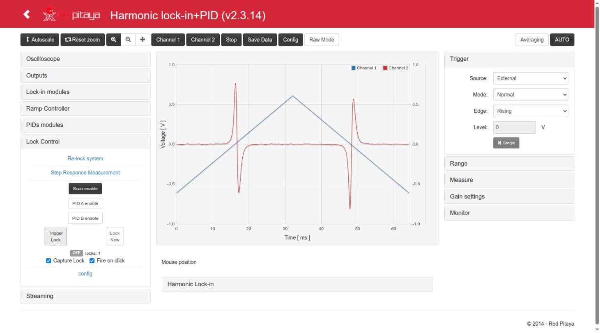

- **Top toolbar**: zoom and acquisition buttons.
- **Left column**: the instruments (Oscilloscope, Outputs, Lock Control, Lock-in modules, Ramp Controller, PIDs
  modules, Streaming; Lock Control is below Outputs since v2.3.27). Each title opens or closes its panel.
- **Centre**: the plot (two Y axes, Channel 1 blue and Channel 2 red), the mouse position, and the
  *Harmonic Lock-in* display (X, Y, R, φ, F1, F2, F3).
- **Right column**: the original scope controls (Trigger, Range, Measure, Gain settings) and the Monitor.

Every change is sent to the board when the field loses focus or Enter is pressed (Escape cancels the edit).
Only changed values are sent. A field left empty (e.g. after Backspace) or with an invalid text is **not** sent:
the last value comes back (up to v2.3.15 an emptied field sent 0).

## Panels

### Toolbar

| Button | Action |
|---|---|
| Autoscale | Rescales the **Y axis** to the data on screen, only in the page. Does not end a lock capture. |
| Reset zoom, zoom in/out, pan | Plot navigation. A zoom selects the time window of the acquisition (the decimation is chosen from it). Reset zoom (v2.3.21) sets the window from t = 0 to one period of the ramp (Ext Trig = Scan floor / Scan ceil), one period of the modulation (Ext Trig = harmonic mod.) or one whole memory at the current decimation (otherwise); for periods of 1.5 s or more (v2.3.23) the window is 0 … 0.98 × the period, so that every scan is acquired ([Slow scans](#slow-scans)); and Y to −1 … 1 V (raw mode −8192 … 8192); during a lock capture it first ends it, as AUTO, and uses the restored Ext Trig. The Raw Mode button rescales Y the same way. |
| Mouse wheel on the plot (v2.3.22) | Zoom centred on the mouse, 1.5× per step. **No key:** both axes (time and the two Y axes). **SHIFT** held: time axis only (the cursor becomes a horizontal double arrow ↔). **ALT** held: Y axes only (vertical double arrow ↕; in raw mode the Y range is in counts). The time window is sent to the controller once the wheel stops (250 ms), which chooses the decimation as for any zoom; it stays between 20 ns and 68.7 s (one memory at the largest decimation). The Y zoom is only in the page (range 1/2048 … 1000 × full scale). During a lock capture (Capture Lock) the wheel zoom is only in the page and does not touch the scope; ending the capture restores the window saved before it. The wheel on the number fields is not affected (SHIFT ×10, CTRL ×100). |
| Channel 1 / Channel 2 | Show or hide each channel. |
| Stop | Stops the acquisition. |
| Save Data | Plot data as Python/Numpy, Matlab/Octave or CSV ([Saving data](#saving-data)). |
| Config | Save / load configurations ([below](#saving-and-loading-configurations)). |
| Raw Mode | Values in counts (`int`) instead of volts. |
| Averaging | Average inside the decimation. |
| **AUTO** | Auto-set of the scope in the controller (time range, trigger, Y range). Ends a lock capture. Not the same as *Autoscale*. |

### Oscilloscope

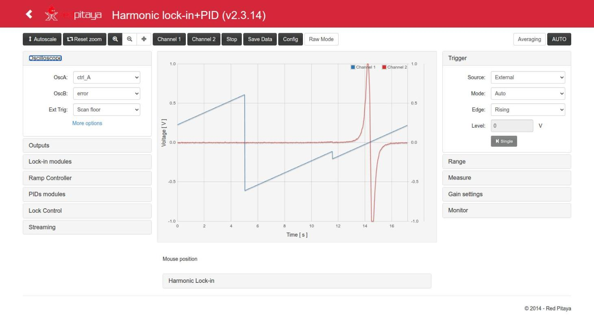

- **OscA / OscB**: signal shown on Channel 1 / Channel 2 (any of 25 internal signals:
  in1, in2, error, ctrl_A, ctrl_B, Ramp A/B, PID inputs/outputs, references, Xo, Yo, F1o..F3o, signal_i,
  out1, out2). The fast inputs are seen with `in1`/`in2`.
- **Ext Trig**: event used when the scope trigger *Source* is *External*: None, Pin (DIO0_P), Scan floor,
  Scan ceil, harmonic mod. (start of each modulation period), Out of lock, Jump trigger, Lock control trig
  (the lock event; used by Capture Lock). *Square mod.* is not implemented (always 0 in the FPGA) and is not in the
  menu since v2.3.25.
  Since v2.3.24, picking an Ext Trig other than the current one and not *None* also sets the *Trigger* panel to
  *Source* = External and *Mode* = Normal (one POST). *None* changes nothing else; *Config load*, the end of a
  Capture Lock, *Reset zoom* and *AUTO* keep their own trigger settings.
- **Presets** (v2.3.24): small buttons below Ext Trig that set OscA|OscB in one click: `in1|in2`, `in1|ctrl`
  (in1, ctrl_A), `X|Y` (Xo, Yo) in blue; `in1|err` (in1, error), `ctrl|err` (ctrl_A, error) and `usr` in green.
  They change only the two signals: not the zoom, not the trigger, not a lock capture. `usr` is a pair of your
  own: **double click** on it (or a click while it is not configured; dashed border) opens a dialog with the two
  signals; *Accept* saves it in the browser and shows it. The pair is also saved in the configs (*Config*: save and
  download; older configs without it keep the current one). The tooltip of each button names its two signals.
- **More options**: *R|Phase Mode* (disabled in this version) and *Disable anti-aliasing filter* for each
  channel.

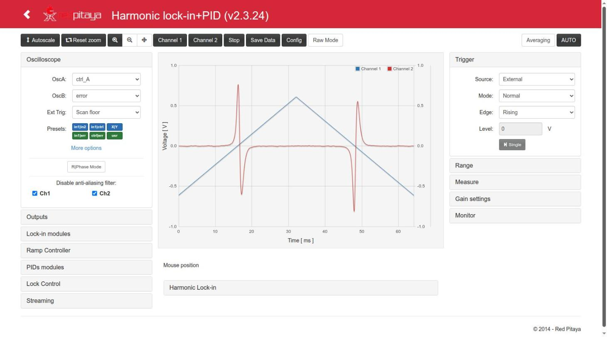

### Outputs

- **Out1 / Out2**: signal sent to each fast output (±1 V): 0, in1, in2, in1−in2, error, cos_1f, cos_2f,
  cos_3f, cos_ref, sin_ref, PID A out, PID B out, ctrl_A, ctrl_B, aux_A, aux_B. For a lock, Out1 = ctrl_A
  (ramp + PID A) is the usual choice.
- **Slow outputs**: four selectors. **They have no effect in this version** (the slow outputs are not
  driven by the FPGA, see [App.md](App.md#inputs-and-outputs)).

### Lock-in modules

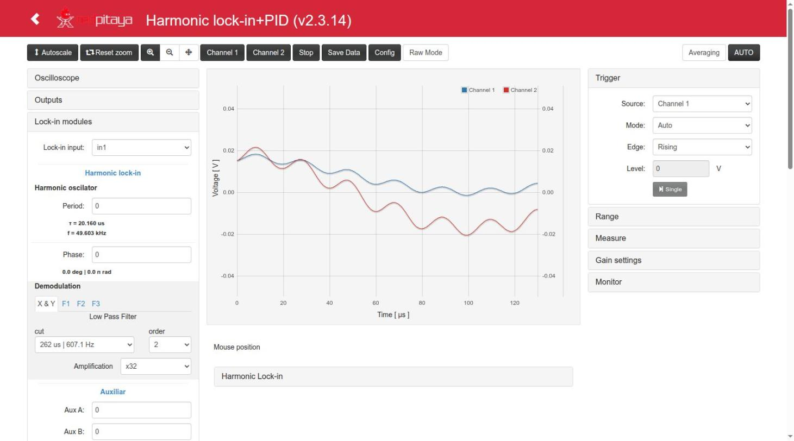

- **Lock-in input**: signal to demodulate (in1, in2, in1−in2, cos_ref, sin_ref, cos_1f, aux_A, Ramp A).
- **Harmonic oscillator**: *Period* (`gen_mod_hp`, shows τ and f below: 0 → 49.603 kHz) and *Phase* of the
  F1/F2/F3 references (0..2519 = 0..360°).
- **Demodulation**: tabs *X & Y*, *F1*, *F2*, *F3*, each with its low-pass filter (*cut* = τ | f, *order*
  OFF/1/2) and *Amplification* (×2ⁿ).
- **Auxiliar**: *Aux A*, *Aux B* constants, and **Modulation Amplitude** *A Out1* / *A Out2*: amplitude of
  the reference added to OUT1 (`cos_ref`) / OUT2 (`sin_ref`); −1 = off, 0..8191 (≈ value/16384 V).

### Ramp Controller

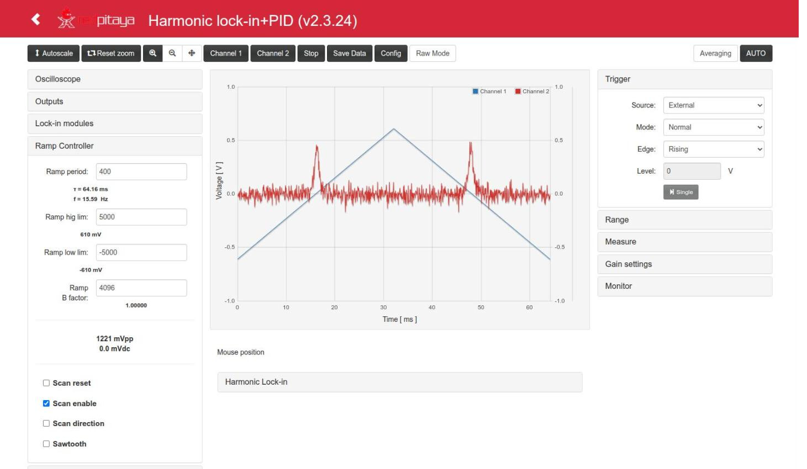

- **Ramp period** (`ramp_step`: ticks per step − 1; below, the resulting period τ and frequency f),
  **Ramp hig lim**, **Ramp low lim** (in counts, with the value in mV below), **Ramp B factor**
  (4096 = 1: ratio of Ramp B to Ramp A). The amplitude (mVpp) and centre (mVdc) are shown below.
- **Scan reset** (hold at 0), **Scan enable** (the ramp runs; the *Scan enable* button of Lock Control
  must also be on), **Scan direction**, **Sawtooth** (otherwise triangle).

In the screenshot (`__scan_mode.json`, OscA = Ramp A, OscB = in1): ±5000 counts (±610 mV, 1221 mVpp), period 400,
triangle (Sawtooth unchecked) → τ = 64.16 ms, f = 15.59 Hz; the two peaks of in1 are seen on the way up and on
the way down. The noise of in1 is that of the configuration, which disables the anti-aliasing filters.

### PIDs modules

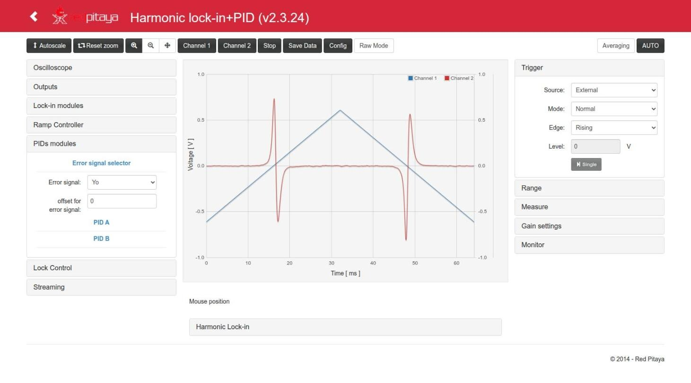

- **Error signal selector**: *Error signal* (0, Xo, Yo, F1o, F2o, F3o, in1, in1−in2) and its *offset*.
- **PID A / PID B**: *input* (error by default), *reset integral*, *freeze out*, *freeze integral*, and
  the gains *kp*, *ki*, *kd* with the effective value written below (kp as a factor, ki and kd as τ and f).
- **More Options** shows the set point *sp*, the scale selectors of kp (/1../4096), ki (8 ns..9 s) and kd
  (7.5 ns..491.5 µs), and *SAT lim* (saturation of the integral term, ±122 µV..±1 V). The ki option 4 is
  labelled "65 us" since v2.3.15 (2¹³ · 8 ns = 65.5 µs; it said "6 us"):

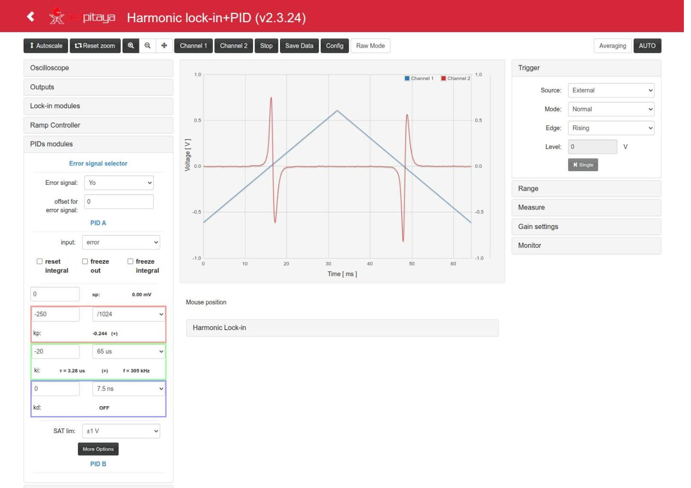

In the example (`lock_mode`) kp = −250 with /1024 gives −0.244, and ki = −20 with 537 ms gives τ = 26.8 ms
(f = 37.3 Hz); kd = 0 (OFF), SAT ±1 V.

### Lock Control

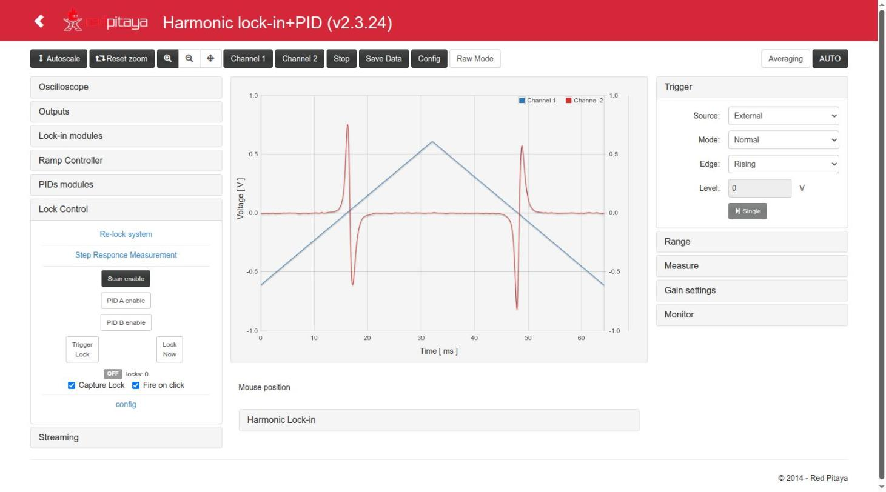

The main part of the panel (from top to bottom):

- **Scan enable / PID A enable / PID B enable**: buttons with the **effective** state of the ramp and the
  PIDs (dark = on). When nothing is locked a click toggles the manual enable; while LOCKED a click
  releases the lock keeping the other enables.
- **Trigger Lock**: arms the lock; it closes when the trigger of the *config* section happens (time,
  level or level+time). **Lock Now**: closes the lock at once. Both stay pressed while requested; a second
  click releases the lock.
- **time / level / time+level** (the three small colored buttons between Trigger Lock and Lock Now; since
  v2.3.28): a shortcut for *Trigger type* + *Choose from graph* + *Fire on click*. Click one (it stays filled while
  it waits, the cursor over the plot is a crosshair and a short note covers the state label and the checkboxes
  below), then click on the plot: the trigger type is set, the time
  and / or level are taken from the click, and *Trigger Lock* fires at once (with *Capture Lock* if checked, even if
  *Fire on click* is unchecked). An active lock is kept until that click, then released and armed again. Esc or a
  second click on the same button cancels.
- **State label**: OFF / ARMED / LOCKED and the number of locks since the FPGA was loaded.
- **Capture Lock** (on by default): every lock request from the page captures the closing of the loop in
  the scope and freezes the trace. **Fire on click** (on by default): with *Choose from graph*, a click on
  the plot sets the trigger value and fires *Trigger Lock*. Design: [`lock_capture.md`](../lock_in+pid_harmonic/doc/lock_capture.md).
- **config** (open it with its title):

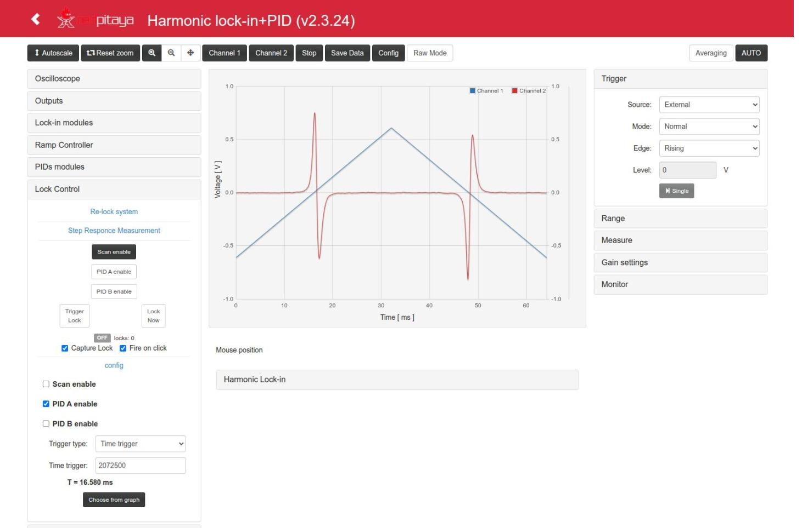

  - *Scan enable*, *PID A enable*, *PID B enable*: what is on **while LOCKED** (usually: scan off, PID A on).
  - *Trigger type*: OFF (only Lock Now), Time trigger, Level Trigger, Level+time Trigger.
  - *Time trigger*: delay after the scan floor, in ticks of 8 ns or with units (`16.58 ms`, `20 s`; see
    [below](#typing-values-with-units)); shown as T below (typing `16.58 ms` gives 2072500, T = 16.580 ms, as in
    the screenshot; the test configuration uses 2072622). 0 = OFF, up to 4294967295 =
    34.36 s (32 bits since v2.3.15; it was limited to 17.18 s).
  - *Signal for trigger*, *Level trigger* (counts or `V`/`mV`, shown in mV below), *trig upward?*: for the level trigger.
  - **Choose from graph**: the next click on the plot sets the time (and/or level) of the trigger. A second
    click on the button (*Cancel*) or Esc cancels it. A red warning appears if the scope is not in
    Normal/Single + External + Scan floor (the only setup where t = 0 of the plot is the scan floor).

- **Re-lock system** and **Step Responce Measurement** (open them with their titles):

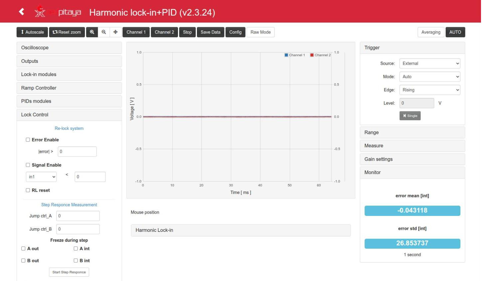

  - Re-lock: *Error Enable* with `|error| >` threshold, *Signal Enable* with a signal `<` threshold,
    *RL reset*. Not tested on this version (see [App.md](App.md#re-lock-and-step-response)).
  - Step response: *Jump ctrl_A*, *Jump ctrl_B*, *Freeze during step* (A/B out, A/B int), *Start Step Responce*.

How the lock control works inside: [`lock_control.md`](../lock_in+pid_harmonic/doc/lock_control.md).

### Streaming

See the Outputs screenshot above.

- **IP** (the *IP* button fills in the address of the computer running the browser), **Port** (6000 for
  the server of `resources/streaming`), **Streaming Rate** (1.95 MS/s .. 1.9 kS/s; 0.98 MS/s is the fastest
  continuous rate).
- **Prepare Streaming** starts `c/streaming` on the board; **Start** / **Stop** send the data.
- Start the receiver on the computer first (`resources/streaming/server`, or `nc -l <port>`); details in
  `resources/README.md`.

### Right panels and displays

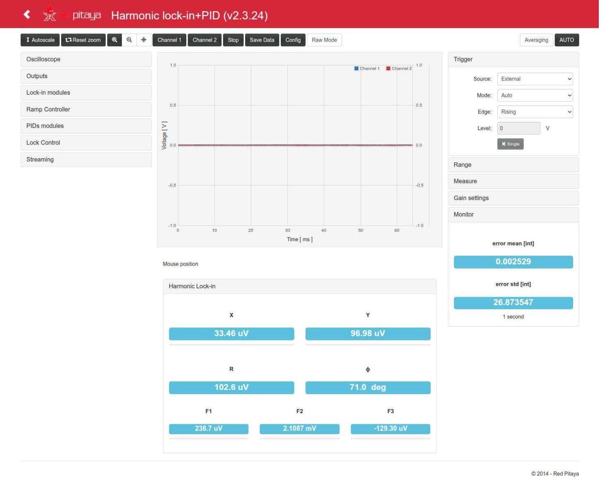

- **Trigger**: *Source* (Channel 1, Channel 2, External), *Mode* (Auto, Normal, Single), *Edge*, *Level*,
  and the *Single* button. External uses the *Ext Trig* of the Oscilloscope panel.
  **Auto** (since v2.3.26) waits for the trigger as *Normal* does (the *Level* of the source channel, or the
  *Ext Trig* with Source = External) and forces an acquisition only when no trigger comes within a time limit:
  the largest of 0.25 s, 1.1 × the window + 50 ms and, when the period of the Ext Trig is known (Scan floor /
  Scan ceil with the scan running, harmonic mod.), 1.1 × that period + 50 ms; at most 80 s. So with Ext Trig = Scan
  floor, t = 0 is the scan floor in Auto too (a 30 s scan in a 0…29.4 s window waits up to 33 s and every scan is
  acquired from its floor), and without a trigger (scan stopped or locked with the ramp off, Ext Trig None, a level
  the signal never crosses) the traces keep coming: every 0.25 s plus the acquisition for short windows. As before,
  an Auto acquisition starts at the trigger (no negative times). Up to v2.3.25 Auto triggered at once, at any phase
  of the scan (Scan floor seemed to trigger at the ceiling). The *Level* field and line work in Auto too.
- **Range**: buttons for the X and Y scales and offsets.
- **Measure**: min, max, amplitude, average, frequency and period of each channel.
- **Gain settings**: probe attenuation (1x/10x) and LV/HV jumper setting of each input (scale of the display).
- **Harmonic Lock-in** (below the plot): X, Y, R, φ, F1, F2, F3 in volts.
- **Monitor**: mean and standard deviation of the error over ~1 s, in counts.

In the screenshot the loop is closed (LOCKED, Mode Auto), so X, Y, R, φ and the Monitor are steady (error std
26.87 counts). During a scan these values change all the time and a reading is only an instant of the sweep.

### Slow scans

With windows of 1.5 s or more (e.g. a 30 s ramp) the scope reads its memory while the FPGA is still writing it.
Since v2.3.23 (CHANGELOG v2.3.23):

- **Reset zoom** on a scan of period T ≥ 1.5 s (Ext Trig = Scan floor / Scan ceil / harmonic mod.) sets the window
  to 0 … 0.98 × T (at least 50 ms before the next trigger), so that the scope is armed again in time and every scan
  is acquired. Shorter periods keep one whole period.
- The trace is drawn **while it is acquired**, only with valid points of the current acquisition (it starts and
  ends at the valid ones, never mixed with an older lap of the memory, and the previous trace is not left to the
  right). In Normal mode the **whole trace is only seen near the end of each scan**: between the end of the
  window (0.98 × T) and the next scan floor.
- **Capture Lock** works with slow scans (Time trigger, Level trigger and Lock Now): the lock request is held until
  the scope has loaded its **history before the lock** (the part of the window before t = 0; banner "loading the
  scope history before the lock (x s)"), then the lock is applied and the capture is drawn as it is acquired
  ("lock captured, acquiring the trace..."). Lock Now on a slow window therefore locks after that history (e.g.
  9 s for a 30 s window), on purpose.
- (FPGA) A time trigger armed after the ramp was stopped (e.g. right after releasing a lock) waits for the next
  scan floor instead of firing in the middle of the scan.

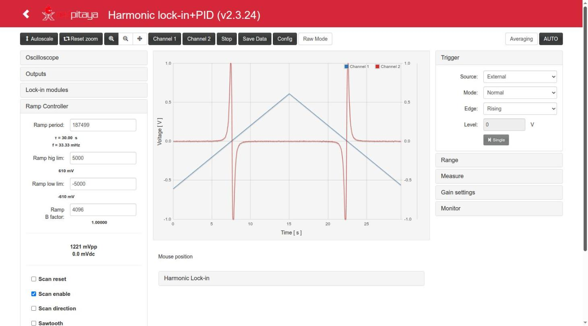

In the screenshot: `lock_mode` with *Ramp period* 187499 (τ = 30.00 s, f = 33.33 mHz), ±5000, Trigger External /
Normal / Scan floor, Reset zoom → 0 … 29.4 s; ctrl_A and error complete up to 29.45 s (1024 points), with the
zero crossings of the error at ≈ 7.8 s and ≈ 22.3 s.

## Typing values with units

Since v2.3.16 the **Time trigger** and **Level trigger** fields of *Lock Control → config* are text fields that
accept a number with a unit (`index.html` l. 2283-2324, `parseTrigTime()`, `parseTrigLevel()`):

| Field | Without unit | Units | Range | Examples |
|---|---|---|---|---|
| Time trigger | ticks of 8 ns | `s` (`seg`), `ms`, `us` (`µs`), `ns`, `tick(s)` | 0 .. 4294967295 (34.36 s); larger values are clamped; a nonzero time below one tick is 1 tick | `16.58 ms` → 2072500, `20 s` → 2500000000, `16,58ms` → 2072500 |
| Level trigger | counts | `V`, `mV`, `count(s)` | −8192 .. 8191 (clamped) | `0.1 V` → 819, `-50 mV` → −410 |

- Decimal point or comma; the space between number and unit is optional; units are not case sensitive.
- The value is sent when the edit ends (Enter or leaving the field); then the field is rewritten in ticks /
  counts and T / V_trg below it are updated. Escape restores the previous value.
- An empty or invalid text (`abc`, `-5 ms`) is not sent: a red hint appears below the field and the last value
  comes back. The mouse wheel changes the value by one tick / count.
- Values above 2²⁴ ticks (134 ms) go through the float parameters of the C controller and are rounded to a
  multiple of 2 to 256 ticks (e.g. `19 s` = 2375000000 is written as 2375000064, 0.5 µs more); see
  [FPGA.md](FPGA.md#lock-control-auto-lock).

Tested on the board (v2.3.16): `20 s`, a pasted `19 s`, `16.58 ms`, `16,58ms`, empty / `abc` / `-5 ms` (nothing
sent), `0` (OFF), `40 s` (→ 4294967295), wheel, Escape; `0.1 V`, `-50 mV`, empty (`reportes/lock-in_pid_h.md`).

 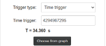

Other fields still have older unit conversions in the JavaScript (`index.html` l. 1856-2331), but they are
`<input type="number">` fields, where browsers do not let letters be typed: **a confirmar** whether they can be
used from the UI. Those conversions are:

| Field | Units |
|---|---|
| Ramp hig/low lim, PID sp | `V`, `mV` (converted to counts) |
| Ramp period | `s`, `ms` (see the limitation below) |
| Period of the harmonic oscillator | `s`, `ms`, `us` |
| Phase | `deg`, `rad`, `pi` |

## Procedures

These procedures follow `test_files/lock_test.md`, the procedure used to test every version on the board.
The example numbers are those of the test configurations `test_files/lock_in+pid_harmonic__scan_mode.json`
and `__lock_mode.json`: a system with a resonance (a peak) whose control input is OUT1 and whose response is
measured on IN1.

### 1. Scan and see the response of the system

1. **Outputs**: Out1 = `ctrl_A`.
2. **Ramp Controller**: limits ±5000 (±610 mV), period 400 (triangle: 64.16 ms), *Scan enable* checked.
3. **Lock Control**: *Scan enable* button on, *PID A enable* off.
4. **Oscilloscope**: OscA = `Ramp A` (or `ctrl_A`), OscB = `in1`; Ext Trig = *Scan floor*.
5. **Trigger**: Source *External*, Mode *Normal* (picking an Ext Trig already sets them, v2.3.24). Press
   **Reset zoom**: the window goes from 0 to one period of the ramp (0 … 64.16 ms) and t = 0 is the scan floor.
   The preset `in1|ctrl` sets the same pair in one click (with in1 on Channel 1 and ctrl_A on Channel 2).

The response of the system (the peak) appears on Channel 2 at the same position in every sweep.

### 2. Configure the lock-in to get an error signal

The lock-in, with a small modulation added to the control signal, gives a signal proportional to the
derivative of the response with respect to the scan: it crosses zero at the maximum of the peak, which is
the error signal for the PID.

1. **Lock-in modules**: Lock-in input = `in1`; Period = 0 (49.6 kHz); *A Out1* = 100 (modulation of ≈ 6 mV
   added to OUT1); X & Y filter 262 µs | 607 Hz, order 2; Amplification ×32.
2. Look at `Xo` and `Yo` (OscA/OscB) during the scan: change the *Phase* of the references or choose the
   component (X or Y) that gives a clean dispersive curve with a zero crossing at the peak.
3. **PIDs modules**: Error signal = that component (`Yo` in the test configuration), offset 0.
4. OscA = `ctrl_A`, OscB = `error` (preset `ctrl|err`):

### 3. Close the lock

1. **PID A**: input = error, kp = −250 (/1024, −0.244), ki = −20 (537 ms, τ = 26.8 ms). The sign of the gains has to give
   negative feedback around the zero crossing (try the other sign if the lock runs away).
2. **Lock Control → config**: while locked, *PID A enable* on and *Scan enable* off.
3. Choose the trigger:
   - **Time trigger**: press *Choose from graph* and click on the zero crossing of the error (16.58 ms in
     the example). With *Fire on click* on, the click also fires *Trigger Lock*.
   - Shortcut: press the small **time** (or **level**, **time+level**) button between *Trigger Lock* and
     *Lock Now* and click on the plot: type, value and *Trigger Lock* in one go (steps 3 and 4).
   - **Level trigger**: Signal for trigger = error, Level = a value the error reaches just before the
     crossing (5085 counts, V_trg = 621 mV, in the test), *trig upward?* according to the slope.
   - **Lock Now**: locks immediately wherever the ramp is (useful only when the system is already near the
     point).
4. Press **Trigger Lock**. The state goes OFF → ARMED → LOCKED in the next sweep; with *Capture Lock* the
   scope shows the closing of the loop (t = 0 is the lock) and keeps it frozen:

With the level trigger the lock is placed at 30 % of the window:

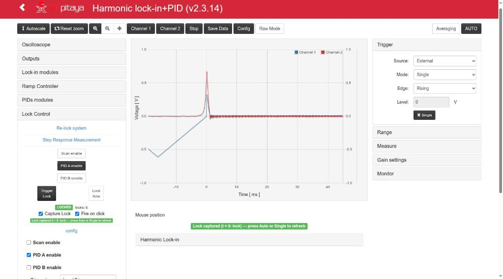

Fire on click on a frozen capture moves the lock point and locks again (GIF):

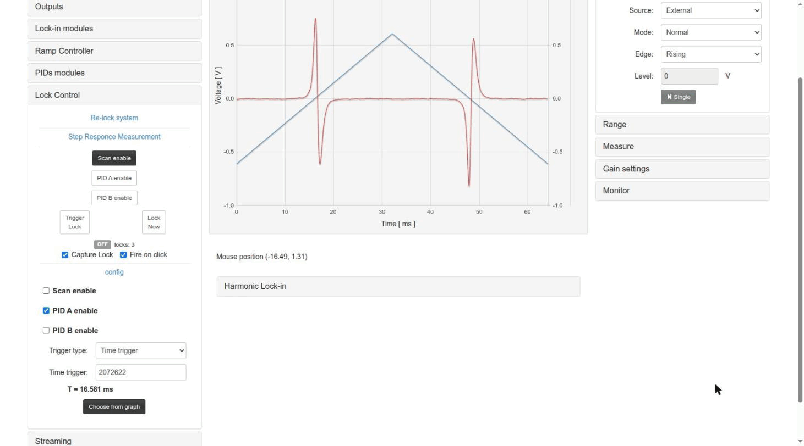

If *Choose from graph* shows the red warning, t = 0 of the plot is not the scan floor and the time taken
from the click would be wrong:

The frozen capture ends (and the scope settings saved before the capture are restored) with trigger mode
Auto/Normal, *Single*, **AUTO**, a change of source or Ext Trig, unchecking *Capture Lock*, or a release
while waiting. *Autoscale* keeps it.

### 4. Check the lock and release it

1. Set the trigger Mode to **Auto**: the ramp has stopped and the error stays at 0 (OscA = `ctrl_A`,
   OscB = `error`):

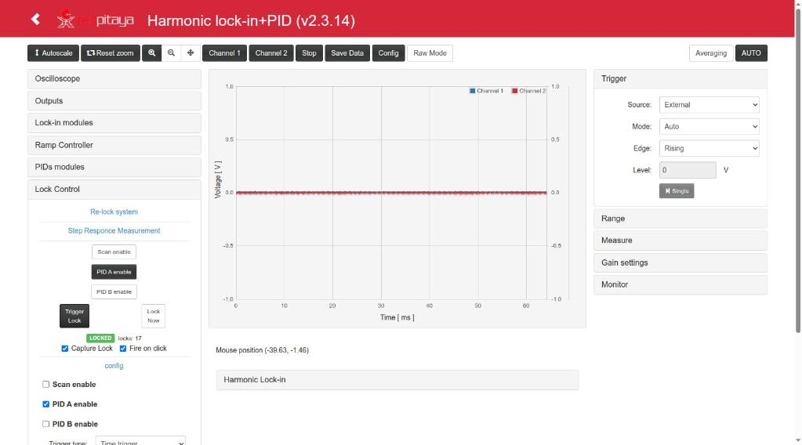

2. With OscA = `in1` (preset `in1|err`) the signal stays at the top of the peak (1.01–1.03 × the peak in the tests):

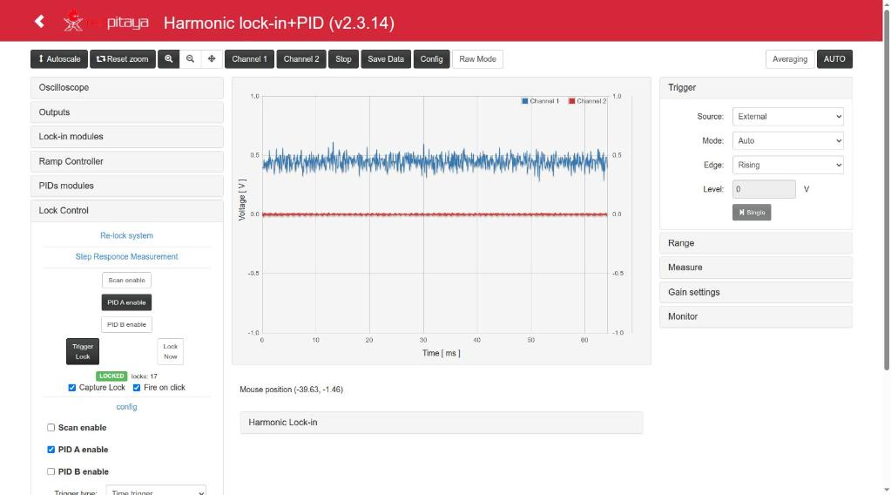

3. The **Monitor** panel shows the mean (≈ 0) and the std of the error: ≈ 27 counts ≈ 3.3 mV with kp = −250
   (26.85 counts in the [screenshot](#lock-control) of the Monitor; `test_files/lock_test.md`). With the kp = −500 of
   the configurations before 2026-10-12 it was ≈ 60 counts ≈ 7–8 mV.
4. **Release**: a second click on *Trigger Lock* (or *Lock Now*), or a click on *Scan enable* (restarts the
   scan with the PIDs as they were).

A lock can also be closed and checked without the web page, with `py/lock_from_registers.py` on the board
or over HTTP (see [Remote.md](Remote.md)); the page follows the state without sending anything.

## Saving and loading configurations

**Config** opens the configuration dialog:

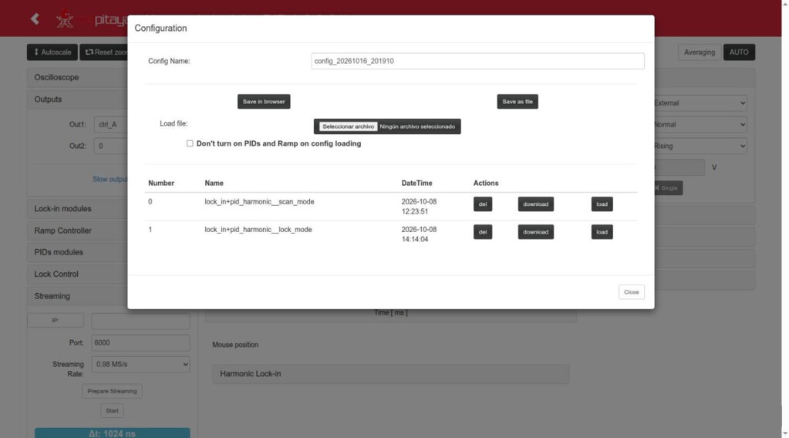

- *Save in browser* stores all the parameters (and the Capture Lock / Fire on click preferences) under the
  *Config Name* in the browser (`localStorage`, key specific of this App). *Save as file* downloads a JSON.
- The list shows the saved configs with *del*, *download* and *load*. *Load file* adds a JSON file to the list
  (then press its *load*).
- **Don't turn on PIDs and Ramp on config loading**: **unchecked by default** (since v2.3.26; up to 2.3.25 it was
  checked). Unchecked, *load* (also of a *Load file*) sets the ramp (*Scan enable* and the Lock Control ramp
  enable) and the PIDs as they are in the config: a config saved while scanning loads scanning. Checked, a loaded
  config never turns them on (useful when the outputs are connected to an experiment). The same option applies to
  the restore of the last config / tab state after a start / *Restart*. A lock request (*Lock Now*, *Trigger Lock*) is never
  loaded. The option is not saved: every page load starts with it unchecked.
- Configs are per browser, not stored on the board.
- **Load last config on init** (since v2.3.27): **checked by default**; the choice is kept in the browser
  (`localStorage`, key of this App). The page saves the current settings automatically every ~2 s (the *last
  config*, also in `localStorage`). Checked, each time the page starts the App (main menu, new tab, F5) it restores
  the last config; unchecked, the App starts with its defaults. The ramp / PIDs of the restored config follow the
  option above; a lock request is never restored.
- **Load last config** / **Reset to defaults** (since v2.3.27): close the dialog and restart the App (the page reloads,
  the FPGA is reloaded: outputs and lock are reset) with the last config / with the default parameters of the App (as
  a fresh start: lock open, ramp stopped, PID gains 0), whatever the checkbox says. After *Reset to defaults* (or an
  open with the box unchecked) the last config is kept until a parameter is changed, so *Load last config* brings it
  back.
- **Time window** (v2.3.17): *load* applies the time window of the config in the units it was saved with.
  The config keeps `xmin`/`xmax` in the time units of the moment it was saved (µs, ms or s); the page converts
  them to seconds, sets the window in the current units and then takes the window and units that the server
  ends with (the answer of the last of the 5-9 POSTs of a load), so page, axes and server agree. The scale values
  that the server derives (`time_units`, `time_range`, `gui_xmin`, `gui_xmax`, `forcex_flag`) are not loaded nor
  sent. Up to v2.3.16 the window was taken in the units of the server (`lock_mode`, saved in ms, loaded with the
  scope in µs gave −2…33 **µs**) or not applied at all. Tested on the board: 14/14 loads (from 0-131 µs,
  10-120 µs, 0-10 ms, 0-2 s, and a config in µs loaded with the page in ms).
- A load ends a frozen lock capture (the config brings its own scope settings).

## Saving data

*Save Data* gives the data of the plot as Python/Numpy vectors, Matlab/Octave vectors or CSV (save as a
file, copy or show).

## Several clients and Restart

Only one browser tab should control the board. When another client (another tab, the main menu, another
App) takes the board, the page stops polling and shows a dialog:

*Restart* restarts the App and restores the state of this tab (if the other client loaded the same App,
the FPGA is not reloaded), with *Load last config on init* checked or not. On Ecosystem 2.0 the page also enters a "cautious mode" when the board answers
slowly, and waits until it answers fast again.

## Known limitations of the interface

- The **Slow outputs** selectors have no effect; the **R|Phase Mode** button is disabled.
- *Time trigger* values above 2²⁴ ticks (134 ms) set from the page are rounded to the float32 grid (≤ 1 µs).
- *Ramp period* typed in `s`/`ms` sets `ramp_step` for (hig − low) steps, i.e. half of the period in
  triangle mode (`index.html` l. 1908-1913): check the τ shown below the field.
- The labels of *Signal for trigger* 6-8 show code text (`/*sqXo */ 14'b0`): those options are 0.
- Each change made in the page is a `POST /data`, and on Ecosystem 2.0 each one leaves an open connection in the
  nginx of the board; after ~1000 the board stops answering until nginx is restarted
  ([Remote.md](Remote.md#known-issue-of-the-ecosystem-post-data-leaves-connections-open)).
- Level+time with the time after the level crossing stays ARMED (the level crossing has to happen after
  the time).

These items are listed for devAgent in `docAgent.md`.
