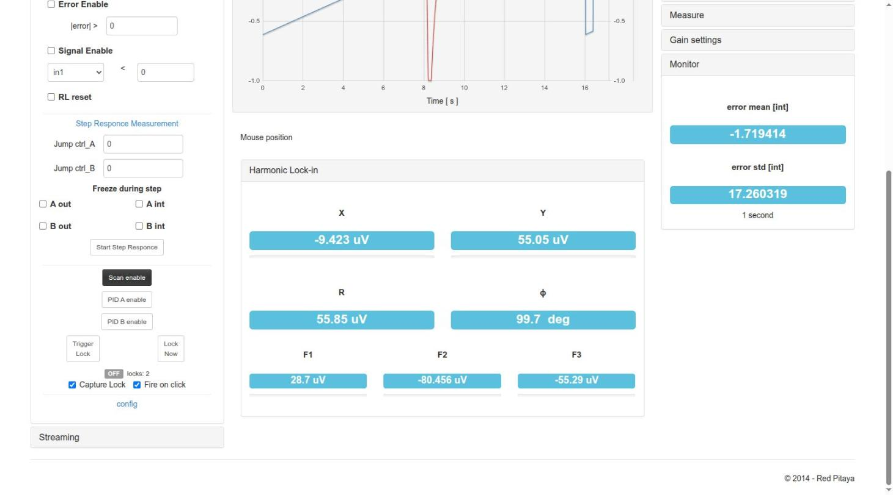

# Using the App from the web interface

How to use `lock_in+pid_harmonic` **v2.3.14** from the browser, panel by panel, and the usual procedures:
scan, see a peak, get an error signal with the lock-in, close a lock and check it. Technical data of each
instrument is in [App.md](App.md); registers in [FPGA.md](FPGA.md).

- [Opening the App](#opening-the-app)
- [Layout of the page](#layout-of-the-page)
- [Panels](#panels)
  - [Toolbar](#toolbar) · [Oscilloscope](#oscilloscope) · [Outputs](#outputs) ·
    [Lock-in modules](#lock-in-modules) · [Ramp Controller](#ramp-controller) ·
    [PIDs modules](#pids-modules) · [Lock Control](#lock-control) · [Streaming](#streaming) ·
    [Right panels and displays](#right-panels-and-displays)
- [Typing values with units](#typing-values-with-units)
- [Procedures](#procedures)
  1. [Scan and see the response of the system](#1-scan-and-see-the-response-of-the-system)
  2. [Configure the lock-in to get an error signal](#2-configure-the-lock-in-to-get-an-error-signal)
  3. [Close the lock (Trigger Lock / Lock Now)](#3-close-the-lock)
  4. [Check the lock and release it](#4-check-the-lock-and-release-it)
- [Saving and loading configurations](#saving-and-loading-configurations)
- [Saving data](#saving-data)
- [Several clients and Restart](#several-clients-and-restart)
- [Known limitations of the interface](#known-limitations-of-the-interface)

The screenshots were taken on RP2 (RedPitaya_OS 2.04-35) with v2.3.14, during the lock tests of
`reportes/lock-in_pid_h_lock_test/` (a simulated peak made by `dummy_simulator` on a second board) and
while writing this page.

## Opening the App

Install the App (see the [README](../README.md#installation)) and open
`http://rp-XXXXXX.local/lock_in+pid_harmonic/` (or choose it in the main menu of the Red Pitaya). The page
starts the App (loads the FPGA and the C controller) and restores the state of the previous session of the
same browser tab. Use a single tab per board (see [Several clients and Restart](#several-clients-and-restart)).

## Layout of the page

- **Top toolbar**: zoom and acquisition buttons.
- **Left column**: the instruments (Oscilloscope, Outputs, Lock-in modules, Ramp Controller, PIDs modules,
  Lock Control, Streaming). Each title opens or closes its panel.
- **Centre**: the plot (two Y axes, Channel 1 blue and Channel 2 red), the mouse position, and the
  *Harmonic Lock-in* display (X, Y, R, φ, F1, F2, F3).
- **Right column**: the original scope controls (Trigger, Range, Measure, Gain settings) and the Monitor.

Every change is sent to the board when the field loses focus or Enter is pressed (Escape cancels the edit).
Only changed values are sent.

## Panels

### Toolbar

| Button | Action |
|---|---|
| Autoscale | Rescales the **Y axis** to the data on screen, only in the page. Does not end a lock capture. |
| Reset zoom, zoom in/out, pan | Plot navigation. A zoom selects the time window of the acquisition (the decimation is chosen from it). |
| Channel 1 / Channel 2 | Show or hide each channel. |
| Stop | Stops the acquisition. |
| Save Data | Plot data as Python/Numpy, Matlab/Octave or CSV ([Saving data](#saving-data)). |
| Config | Save / load configurations ([below](#saving-and-loading-configurations)). |
| Raw Mode | Values in counts (`int`) instead of volts. |
| Averaging | Average inside the decimation. |
| **AUTO** | Auto-set of the scope in the controller (time range, trigger, Y range). Ends a lock capture. Not the same as *Autoscale*. |

### Oscilloscope

- **OscA / OscB**: signal shown on Channel 1 / Channel 2 (any of 25 internal signals:
  in1, in2, error, ctrl_A, ctrl_B, Ramp A/B, PID inputs/outputs, references, Xo, Yo, F1o..F3o, signal_i,
  out1, out2). The fast inputs are seen with `in1`/`in2`.
- **Ext Trig**: event used when the scope trigger *Source* is *External*: None, Pin (DIO0_P), Scan floor,
  Scan ceil, harmonic mod. (start of each modulation period), Out of lock, Jump trigger, Lock control trig
  (the lock event; used by Capture Lock). *Square mod.* is not implemented.
- **More options**: *R|Phase Mode* (disabled in this version) and *Disable anti-aliasing filter* for each
  channel.

### Outputs

- **Out1 / Out2**: signal sent to each fast output (±1 V): 0, in1, in2, in1−in2, error, cos_1f, cos_2f,
  cos_3f, cos_ref, sin_ref, PID A out, PID B out, ctrl_A, ctrl_B, aux_A, aux_B. For a lock, Out1 = ctrl_A
  (ramp + PID A) is the usual choice.
- **Slow outputs**: four selectors. **They have no effect in this version** (the slow outputs are not
  driven by the FPGA, see [App.md](App.md#inputs-and-outputs)).

### Lock-in modules

- **Lock-in input**: signal to demodulate (in1, in2, in1−in2, cos_ref, sin_ref, cos_1f, aux_A, Ramp A).
- **Harmonic oscillator**: *Period* (`gen_mod_hp`, shows τ and f below: 0 → 49.603 kHz) and *Phase* of the
  F1/F2/F3 references (0..2519 = 0..360°).
- **Demodulation**: tabs *X & Y*, *F1*, *F2*, *F3*, each with its low-pass filter (*cut* = τ | f, *order*
  OFF/1/2) and *Amplification* (×2ⁿ).
- **Auxiliar**: *Aux A*, *Aux B* constants, and **Modulation Amplitude** *A Out1* / *A Out2*: amplitude of
  the reference added to OUT1 (`cos_ref`) / OUT2 (`sin_ref`); −1 = off, 0..8191 (≈ value/16384 V).

### Ramp Controller

- **Ramp period** (`ramp_step`: ticks per step − 1; below, the resulting period τ and frequency f),
  **Ramp hig lim**, **Ramp low lim** (in counts, with the value in mV below), **Ramp B factor**
  (4096 = 1: ratio of Ramp B to Ramp A). The amplitude (mVpp) and centre (mVdc) are shown below.
- **Scan reset** (hold at 0), **Scan enable** (the ramp runs; the *Scan enable* button of Lock Control
  must also be on), **Scan direction**, **Sawtooth** (otherwise triangle).

In the screenshot: ±5000 counts (±610 mV), period 200000, sawtooth → 16.0 s.

### PIDs modules

- **Error signal selector**: *Error signal* (0, Xo, Yo, F1o, F2o, F3o, in1, in1−in2) and its *offset*.
- **PID A / PID B**: *input* (error by default), *reset integral*, *freeze out*, *freeze integral*, and
  the gains *kp*, *ki*, *kd* with the effective value written below (kp as a factor, ki and kd as τ and f).
- **More Options** shows the set point *sp*, the scale selectors of kp (/1../4096), ki (8 ns..9 s) and kd
  (7.5 ns..491.5 µs), and *SAT lim* (saturation of the integral term, ±122 µV..±1 V).

In the example kp = −500 with /1024 gives −0.488, and ki = −20 with 537 ms gives τ = 26.8 ms.

### Lock Control

The main part of the panel (from top to bottom):

- **Scan enable / PID A enable / PID B enable**: buttons with the **effective** state of the ramp and the
  PIDs (dark = on). When nothing is locked a click toggles the manual enable; while LOCKED a click
  releases the lock keeping the other enables.
- **Trigger Lock**: arms the lock; it closes when the trigger of the *config* section happens (time,
  level or level+time). **Lock Now**: closes the lock at once. Both stay pressed while requested; a second
  click releases the lock.
- **State label**: OFF / ARMED / LOCKED and the number of locks since the FPGA was loaded.
- **Capture Lock** (on by default): every lock request from the page captures the closing of the loop in
  the scope and freezes the trace. **Fire on click** (on by default): with *Choose from graph*, a click on
  the plot sets the trigger value and fires *Trigger Lock*. Design: [`lock_capture.md`](../lock_in+pid_harmonic/doc/lock_capture.md).
- **config** (open it with its title):

  - *Scan enable*, *PID A enable*, *PID B enable*: what is on **while LOCKED** (usually: scan off, PID A on).
  - *Trigger type*: OFF (only Lock Now), Time trigger, Level Trigger, Level+time Trigger.
  - *Time trigger*: delay after the scan floor, in ticks of 8 ns (shown as T below; 2072622 = 16.58 ms).
  - *Signal for trigger*, *Level trigger* (in counts, shown in mV below), *trig upward?*: for the level trigger.
  - **Choose from graph**: the next click on the plot sets the time (and/or level) of the trigger. A second
    click on the button (*Cancel*) or Esc cancels it. A red warning appears if the scope is not in
    Normal/Single + External + Scan floor (the only setup where t = 0 of the plot is the scan floor).

- **Re-lock system** and **Step Responce Measurement** (open them with their titles):

  - Re-lock: *Error Enable* with `|error| >` threshold, *Signal Enable* with a signal `<` threshold,
    *RL reset*. Not tested on this version (see [App.md](App.md#re-lock-and-step-response)).
  - Step response: *Jump ctrl_A*, *Jump ctrl_B*, *Freeze during step* (A/B out, A/B int), *Start Step Responce*.

How the lock control works inside: [`lock_control.md`](../lock_in+pid_harmonic/doc/lock_control.md).

### Streaming

See the Outputs screenshot above.

- **IP** (the *IP* button fills in the address of the computer running the browser), **Port** (6000 for
  the server of `resources/streaming`), **Streaming Rate** (1.95 MS/s .. 1.9 kS/s; 0.98 MS/s is the fastest
  continuous rate).
- **Prepare Streaming** starts `c/streaming` on the board; **Start** / **Stop** send the data.
- Start the receiver on the computer first (`resources/streaming/server`, or `nc -l <port>`); details in
  `resources/README.md`.

### Right panels and displays

- **Trigger**: *Source* (Channel 1, Channel 2, External), *Mode* (Auto, Normal, Single), *Edge*, *Level*,
  and the *Single* button. External uses the *Ext Trig* of the Oscilloscope panel.
- **Range**: buttons for the X and Y scales and offsets.
- **Measure**: min, max, amplitude, average, frequency and period of each channel.
- **Gain settings**: probe attenuation (1x/10x) and LV/HV jumper setting of each input (scale of the display).
- **Harmonic Lock-in** (below the plot): X, Y, R, φ, F1, F2, F3 in volts.
- **Monitor**: mean and standard deviation of the error over ~1 s, in counts.

## Typing values with units

The JavaScript of the page converts a number followed by a unit, separated by a space (e.g. `16.58 ms`),
into counts or ticks (`index.html` l. 1781-2245). **A confirmar:** these fields are `<input type="number">`
in this version, and browsers do not let letters be typed in a number field, so the units probably cannot be
used from the UI any more (they were text fields in older versions). The conversions are:

| Field | Units |
|---|---|
| Ramp hig/low lim, Level trigger, PID sp | `V`, `mV` (converted to counts) |
| Ramp period | `s`, `ms` (see the limitation below) |
| Period of the harmonic oscillator | `s`, `ms`, `us` |
| Phase | `deg`, `rad`, `pi` |
| Time trigger | `s`, `ms`, `us` |

## Procedures

These procedures follow `test_files/lock_test.md`, the procedure used to test every version on the board.
The example numbers are those of the test configurations `test_files/lock_in+pid_harmonic__scan_mode.json`
and `__lock_mode.json`: a system with a resonance (a peak) whose control input is OUT1 and whose response is
measured on IN1.

### 1. Scan and see the response of the system

1. **Outputs**: Out1 = `ctrl_A`.
2. **Ramp Controller**: limits ±5000 (±610 mV), period 400 (triangle: 64.16 ms), *Scan enable* checked.
3. **Lock Control**: *Scan enable* button on, *PID A enable* off.
4. **Oscilloscope**: OscA = `Ramp A` (or `ctrl_A`), OscB = `in1`; Ext Trig = *Scan floor*.
5. **Trigger**: Source *External*, Mode *Normal*. Zoom to one period of the ramp (0..64 ms): t = 0 is the
   scan floor.

The response of the system (the peak) appears on Channel 2 at the same position in every sweep.

### 2. Configure the lock-in to get an error signal

The lock-in, with a small modulation added to the control signal, gives a signal proportional to the
derivative of the response with respect to the scan: it crosses zero at the maximum of the peak, which is
the error signal for the PID.

1. **Lock-in modules**: Lock-in input = `in1`; Period = 0 (49.6 kHz); *A Out1* = 100 (modulation of ≈ 6 mV
   added to OUT1); X & Y filter 262 µs | 607 Hz, order 2; Amplification ×32.
2. Look at `Xo` and `Yo` (OscA/OscB) during the scan: change the *Phase* of the references or choose the
   component (X or Y) that gives a clean dispersive curve with a zero crossing at the peak.
3. **PIDs modules**: Error signal = that component (`Yo` in the test configuration), offset 0.
4. OscA = `ctrl_A`, OscB = `error`:

### 3. Close the lock

1. **PID A**: input = error, kp = −500 (/1024), ki = −20 (537 ms). The sign of the gains has to give
   negative feedback around the zero crossing (try the other sign if the lock runs away).
2. **Lock Control → config**: while locked, *PID A enable* on and *Scan enable* off.
3. Choose the trigger:
   - **Time trigger**: press *Choose from graph* and click on the zero crossing of the error (16.58 ms in
     the example). With *Fire on click* on, the click also fires *Trigger Lock*.
   - **Level trigger**: Signal for trigger = error, Level = the value of the error just before the
     crossing (5085 counts = 621 mV in the test), *trig upward?* according to the slope.
   - **Lock Now**: locks immediately wherever the ramp is (useful only when the system is already near the
     point).
4. Press **Trigger Lock**. The state goes OFF → ARMED → LOCKED in the next sweep; with *Capture Lock* the
   scope shows the closing of the loop (t = 0 is the lock) and keeps it frozen:

With the level trigger the lock is placed at 30 % of the window:

Fire on click on a frozen capture moves the lock point and locks again (GIF):

If *Choose from graph* shows the red warning, t = 0 of the plot is not the scan floor and the time taken
from the click would be wrong:

The frozen capture ends (and the scope settings saved before the capture are restored) with trigger mode
Auto/Normal, *Single*, **AUTO**, a change of source or Ext Trig, unchecking *Capture Lock*, or a release
while waiting. *Autoscale* keeps it.

### 4. Check the lock and release it

1. Set the trigger Mode to **Auto**: the ramp has stopped and the error stays at 0 (OscA = `ctrl_A`,
   OscB = `error`):

2. With OscA = `in1` the signal stays at the top of the peak (1.01–1.03 × the peak in the tests):

3. The **Monitor** panel shows the mean (≈ 0) and the std of the error (≈ 60 counts ≈ 7–8 mV in the tests).
4. **Release**: a second click on *Trigger Lock* (or *Lock Now*), or a click on *Scan enable* (restarts the
   scan with the PIDs as they were).

A lock can also be closed and checked without the web page, with `py/lock_from_registers.py` on the board
or over HTTP (see [Remote.md](Remote.md)); the page follows the state without sending anything.

## Saving and loading configurations

**Config** opens the configuration dialog:

- *Save in browser* stores all the parameters (and the Capture Lock / Fire on click preferences) under the
  *Config Name* in the browser (`localStorage`, key specific of this App). *Save as file* downloads a JSON.
- The list shows the saved configs with *del*, *download* and *load*. *Load file* loads a JSON file.
- **Don't turn on PIDs and Ramp on config loading**: when checked, a loaded config never turns on the
  ramp, the PIDs or a lock request (safe default when the outputs are connected to an experiment).
- Configs are per browser, not stored on the board.

## Saving data

*Save Data* gives the data of the plot as Python/Numpy vectors, Matlab/Octave vectors or CSV (save as a
file, copy or show).

## Several clients and Restart

Only one browser tab should control the board. When another client (another tab, the main menu, another
App) takes the board, the page stops polling and shows a dialog:

*Restart* restarts the App and restores the state of this tab (if the other client loaded the same App,
the FPGA is not reloaded). On Ecosystem 2.0 the page also enters a "cautious mode" when the board answers
slowly, and waits until it answers fast again.

## Known limitations of the interface

- The **Slow outputs** selectors have no effect; the **R|Phase Mode** button is disabled.
- *Time trigger* values ≥ 2³¹ (17.18 s) are not usable: the FPGA compares only 31 bits.
- *Ramp period* typed in `s`/`ms` sets `ramp_step` for (hig − low) steps, i.e. half of the period in
  triangle mode (`index.html` l. 1831-1836): check the τ shown below the field.
- The labels of *Signal for trigger* 6-8 show code text (`/*sqXo */ 14'b0`): those options are 0.
- The ki scale option 4 is labelled "6 us"; the real value is 2¹³ · 8 ns = 65.5 µs.
- Config → load does not restore the time window of the scope.
- Level+time with the time after the level crossing stays ARMED (the level crossing has to happen after
  the time).

These items are listed for devAgent in `docAgent.md`.
